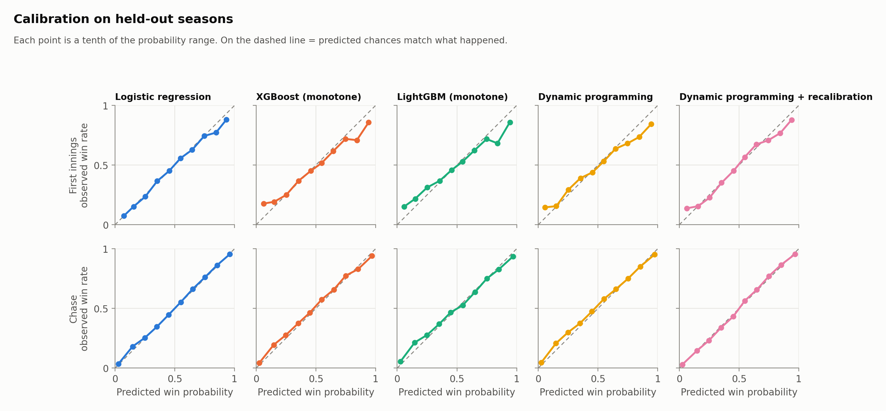
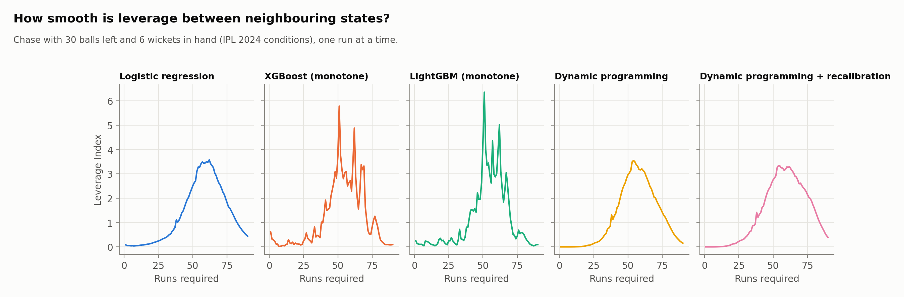
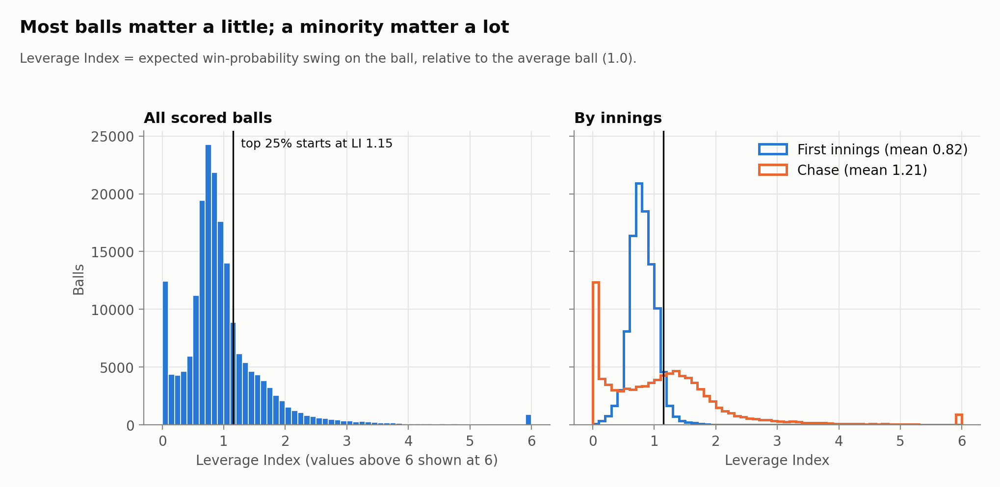
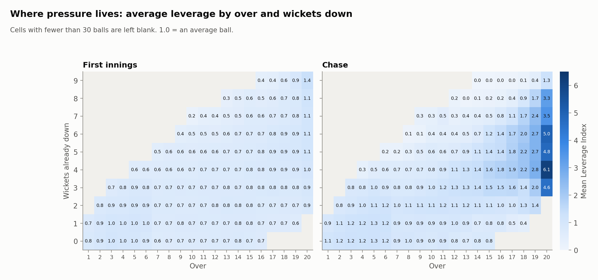
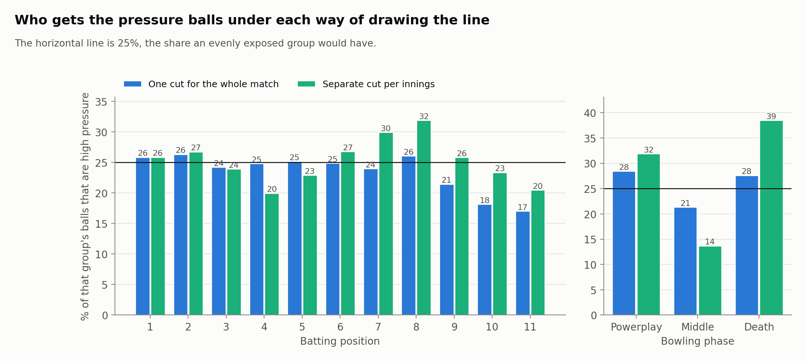
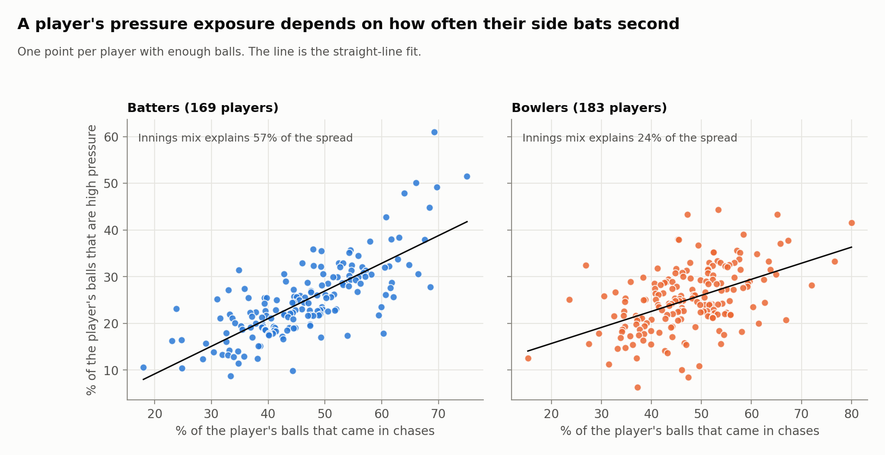
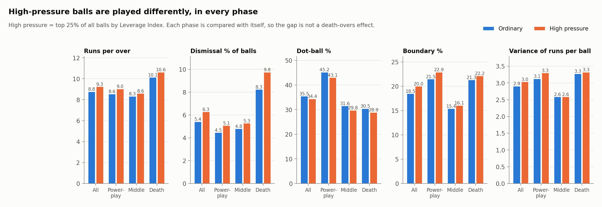
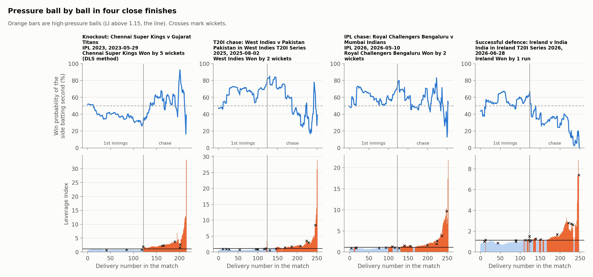

# Phase 2b — Pressure: implementation and evidence

Every number below comes from `python -m src.pipeline` (tables in `outputs/tables/phase2b/`, figures in `outputs/figures/phase2b/`). Scope: 837 IPL and T20I matches with ball data, 193,988 regular-innings balls, of which 193,501 have a usable match state and receive a pressure value.

This version reflects the decisions of 2026-11-17: DP + recalibration as the model, the plain season scoring environment, **one high-pressure cut for the whole match**, and the Impact Player flag dropped. All numbers are from the re-run made after those decisions.

## 1. The definition, in one sentence

> **Pressure on a ball is how much the match result is expected to swing on it: the average change in win probability across everything that could happen on that ball, relative to an average ball.**

Short form for the report header: *"Pressure = how much this ball is expected to move the result."*

Terms used below:

- **Win probability (WP):** chance that the batting side wins from the current state.
- **Leverage Index (LI):** the expected WP swing on the ball divided by the average over all balls. LI 1.0 is an average ball; LI 2.0 matters twice as much.
- **High-pressure ball:** a ball in the top 25% of all balls by LI, which means LI above 1.15.

## 2. What changed from the Phase 2a plan

| # | Change | Why | Status |
|---|---|---|---|
| 1 | **Scoring environment is the plain season average, not "excluding the match itself".** | The exclusion leaked match identity into the models. Full demonstration in Appendix A. | Confirmed |
| 2 | **All 41 rain-affected matches are left out of WP training** (still scored with revised overs and target). | The delivery timestamps cannot reliably show when a revision became known. | Confirmed |
| 3 | **First-innings states assume a chase of the same length as the first innings.** | While the first innings is being played, a later rain cut to the chase is unknown. | Confirmed |
| 4 | **One extra match has an unknown target** (48610). | Its "revised target" is a par score worked out after play stopped. Six second innings in total are not scored. | Recorded |
| 5 | **Impact Player flag dropped.** | Tested; effect negligible (§7). | Decided |
| 6 | **One high-pressure cut for the whole match**, not one per innings. | The role concern did not materialise, and a first-innings cut at LI 0.95 is not defensible (§5). | Decided, to be locked after the exposure review in §5 |

## 3. Which win-probability model

All four candidates saw the same information and were judged the same way: trained on four seasons, tested on the fifth, rotating. 185,070 held-out balls from 774 clean, decided matches.

| Model | Log-loss, all | First innings | Chase | Chase, last 30 balls | Chase, last 12 balls | Brier | Calibration error | Leverage noise, 1st inn / chase |
|---|---|---|---|---|---|---|---|---|
| Logistic regression | **0.5137** | **0.6266** | **0.3909** | 0.2437 | 0.2129 | **0.1743** | **0.0087** | 0.0003 / 0.0067 |
| XGBoost (monotone) | 0.5223 | 0.6376 | 0.3968 | 0.2510 | 0.2179 | 0.1765 | 0.0252 | 0.1981 / 0.1880 |
| LightGBM (monotone) | 0.5297 | 0.6412 | 0.4083 | 0.2620 | 0.2280 | 0.1786 | 0.0325 | 0.2071 / 0.2113 |
| Dynamic programming (DP) | 0.5176 | 0.6340 | 0.3911 | **0.2340** | **0.1994** | 0.1746 | 0.0269 | 0.0006 / 0.0168 |
| **DP + recalibration (chosen)** | 0.5165 | 0.6312 | 0.3916 | 0.2382 | 0.2024 | 0.1753 | 0.0131 | 0.0004 / 0.0164 |

Lower is better in every column. "Leverage noise" compares each state's leverage with the average of its two neighbours one run either side, as a fraction of mean leverage.

**Chosen: DP + recalibration.** The reasoning:

- **The two tree models are out.** They are less accurate (LightGBM significantly so: +0.0132 log-loss, 95% interval +0.0029 to +0.0236), and about 20% of their leverage is noise between neighbouring states. Win probability from trees moves in steps, and leverage is a difference between steps.
- **Logistic and DP + recalibration are tied overall.** The gap is 0.0027 in favour of logistic, with a 95% interval of −0.0098 to +0.0045 from resampling matches. Their leverage values agree closely (rank correlation 0.86; 76% of each one's top-quartile balls are in the other's).
- **The DP is better where pressure is concentrated.** In the last 12 balls of a chase its log-loss is 0.2024 against 0.2129 for logistic. That gap on its own is not statistically significant (interval −0.0071 to +0.0292), so this is a reasoned choice, not a proven one.
- **The DP obeys the laws at the end of an innings.** On the final ball with 1 needed, the chasing side won all 6 times in the held-out data; the DP said 82%, logistic 67%. A fitted curve cannot know that a single wins the match.
- **It is explainable without a black box.** Every probability is a sum over explicit outcome likelihoods (dot, 1, 2, 3, 4, 6, wicket, wide, no-ball) that depend on the state.

**Why the recalibration.** The raw DP is over-confident, most visibly in the first innings. It treats each ball as independent, so it ignores that a whole match can be played on a slow pitch or by a stronger side. A two-parameter rescaling per innings, fitted on the other seasons, halves the calibration error (0.0269 to 0.0131) and keeps the surface smooth.

**Phase 6 check.** Leverage from the logistic model will be run as a sensitivity test.

## 4. What pressure looks like

| | Balls | Mean LI | 10th pct | Median | 75th pct | 90th pct | 99th pct | Max |
|---|---|---|---|---|---|---|---|---|
| All | 193,501 | 1.00 | 0.26 | 0.84 | 1.15 | 1.72 | 4.14 | 33.8 |
| First innings | 102,054 | 0.82 | 0.56 | 0.80 | 0.95 | 1.08 | 1.47 | 3.9 |
| Chase | 91,447 | 1.21 | 0.04 | 1.09 | 1.61 | 2.20 | 5.82 | 33.8 |

**Reading it in plain terms: pressure is high when the contest is close and time is short.**

| Mean LI | Powerplay | Middle overs | Death overs |
|---|---|---|---|
| Chase, even contest (WP 35–65%) | 1.63 | 1.82 | **4.80** |
| Chase, leaning (15–35% or 65–85%) | 1.26 | 1.48 | 3.74 |
| Chase, one-sided (under 15% or over 85%) | 0.52 | 0.44 | 0.72 |
| First innings, even contest | 0.93 | 0.78 | 1.01 |
| First innings, one-sided | 0.53 | 0.40 | 0.49 |

**The five situations from the proposal, measured** (IPL 2024 conditions):

| Situation | Win probability | LI | What I predicted |
|---|---|---|---|
| Chase: need 60 off 12 balls, 8 down | 0.0% | 0.00 | Near zero ✔ |
| Chase: need 9 off 6 balls, 5 down | 81.5% | 5.48 | Very high ✔ |
| Chase: need 20 off 30 balls, 9 down | 46.8% | 3.43 | High ✔ |
| First innings: 25 for 4 after 5 overs | 11.7% | 0.39 | High ✘ |
| First innings: 190 for 2 after 17 overs | 72.1% | 0.79 | Low (it is average for a first innings) |

**I was wrong about the collapse.** I said 25 for 4 would be high leverage. It is the opposite: the damage is already done, win probability is down to 12%, and each further ball can move it only a little. The pressure was on the balls *before* the wickets fell. More generally, **first-innings leverage barely varies**: 80% of first-innings balls sit between LI 0.56 and 1.08.

## 5. Where the high-pressure line is drawn

**Decision: one cut for the whole match.** A ball is high pressure if its LI is above 1.15, the top 25% of all balls.

### 5.1 The two options side by side

| | One cut for the whole match (chosen) | Separate cut per innings (Phase 6 check) |
|---|---|---|
| LI needed to qualify | 1.15 | 0.95 (first innings), 1.61 (chase) |
| First-innings balls that qualify | 5,303 (5.2% of them) | 25,513 (25.0%) |
| Chase balls that qualify | 43,073 (47.1%) | 22,862 (25.0%) |
| First innings' share of the pressure set | 11.0% | 52.7% |
| Mean LI, flagged v unflagged, first innings | 1.38 v 0.78 | 1.10 v 0.72 |
| Mean LI, flagged v unflagged, chase | 2.02 v 0.48 | 2.60 v 0.74 |
| Share of all realised WP movement on flagged balls | 47.9% | 44.3% |
| Matches contributing first-innings / chase pressure balls | 720 / 688 | 829 / 577 |

Why one cut:

- **A per-innings cut is not defensible in the first innings.** It would call a ball "high pressure" at LI 0.95, which is below an average ball.
- **The role concern is resolved.** Batting positions 1–8 all have 24–26% of their balls flagged under one cut (next table).
- **One cut captures more of what actually moved matches**: 47.9% of all realised win-probability movement against 44.3%.

Share of each batting position's balls that are high pressure:

| Batting position | 1 | 2 | 3 | 4 | 5 | 6 | 7 | 8 | 9 | 10 | 11 |
|---|---|---|---|---|---|---|---|---|---|---|---|
| One cut | 25.9% | 26.3% | 24.2% | 24.8% | 25.2% | 24.9% | 24.0% | 26.1% | 21.5% | 18.2% | 17.0% |
| Per innings | 25.9% | 26.8% | 23.9% | 20.0% | 22.9% | 26.8% | 29.9% | 31.9% | 25.8% | 23.4% | 20.5% |

### 5.2 Finding: pressure concentrates in chases

**89% of high-pressure balls are bowled in the second innings.** Nearly half of all chase balls qualify (47.1%), against one in twenty first-innings balls (5.2%).

This is a property of T20 cricket, not of the method. In the first innings nobody knows what a good score is, so no single ball moves the result much. In a chase every ball is measured against a known target. The first-innings balls that do qualify are mostly at the death (58%) and in the powerplay (32%).

### 5.3 Exposure by bowling phase

| | Powerplay | Middle overs | Death overs |
|---|---|---|---|
| **Share of each phase's balls that are high pressure** | | | |
| First innings | 5.5% | 1.1% | 12.4% |
| Chase | 52.2% | 42.8% | 49.1% |
| Both innings | 28.4% | 21.4% | 27.6% |
| **Share of all high-pressure balls** | | | |
| First innings | 3.5% | 1.0% | 6.4% |
| Chase | 32.6% | 38.3% | 18.1% |
| Both innings | 36.2% | 39.3% | 24.5% |

- **No bowling phase is shut out.** Powerplay, middle and death bowlers have 28%, 21% and 28% of their balls flagged.
- **Middle-overs bowlers are a little under-exposed** (21% against 25%), almost entirely because the first-innings middle overs carry no pressure (1.1%).
- **Death overs supply only a quarter of pressure balls.** Many chases are decided before the 16th over, so the death overs of a chase are often played at low stakes. Pressure is not the same thing as "death bowling".

### 5.4 Exposure by player: batting first v chasing

Players with at least 300 balls (169 batters, 183 bowlers). "Chase share" is the share of a player's balls that came in second innings.

| | Batters | Bowlers |
|---|---|---|
| Share of own balls that are high pressure: 10th pct / median / 90th pct | 16.0% / 23.5% / 33.1% | 17.0% / 24.8% / 33.3% |
| Chase share: 10th pct / median / 90th pct | 33% / 46% / 61% | 35% / 47% / 58% |
| Median high-pressure rate in the first innings | 3.5% | 4.3% |
| Median high-pressure rate in chases | 47.9% | 47.8% |
| Extra high-pressure share per 10 points of chase share | +5.9 points | +3.4 points |
| Spread in high-pressure share explained by chase share | 57% | 24% |
| …explained by phase mix (powerplay and death shares) | 6% | 4% |
| …explained by both together | 58% | 33% |

- **For batters, exposure is mostly a toss-and-fixture effect.** How often a batter's side chased explains 57% of the difference between batters. A typical batter at the 90th percentile has twice the pressure share of one at the 10th (33% against 16%).
- **For bowlers the link is weaker (24%).** The rest depends on whether the chases they bowled in stayed close.
- **Phase mix adds almost nothing** for either role (4–6%), consistent with §5.3.
- **Team strength matters too.** Sides that win comfortably see less pressure. India chased in 41% of its T20Is and its batters faced the lowest pressure share of any full member (17.2%). In the IPL the range runs from 19.0% (Kolkata Knight Riders) to 30.5% (Mumbai Indians) with the bat. Full table: `exposure_by_team.csv`.

### 5.5 What this means for the next phases

- **Exposure changes the amount of evidence on a player, not the level of their score**, provided each ball is judged against what is expected in its own situation. That is the first requirement of Phase 3.
- **Sample sizes will be uneven.** A regular in a side that usually bats first can have half the pressure balls of an equal player elsewhere. Minimum-ball thresholds and shrinkage in Phase 5 have to handle this.
- **"Pressure" in the final ranking largely means "pressure in chases".** The report should say so plainly. The per-innings cut in Phase 6 shows how much the ranking depends on that.

## 6. Proof that pressure balls are different

| | Ordinary | High pressure |
|---|---|---|
| Balls | 145,125 | 48,376 |
| Runs per over | 8.78 | 9.25 |
| Dismissal % of balls | 5.43 | 6.29 |
| Dot-ball % | 35.5 | 34.4 |
| Boundary % | 18.5 | 20.0 |
| Variance of runs per ball | 2.91 | 3.04 |
| Realised WP swing per ball | 0.89% | 2.49% |

- **Direction is the same in every phase** (chart): more runs, more wickets, fewer dots, more boundaries. High-pressure cricket is higher-risk, higher-reward cricket, and that holds when the powerplay is compared with the powerplay and the death with the death.
- **The stakes are real.** A quarter of the balls carry 48% of all realised win-probability movement.
- The realised-swing row partly restates the definition, so the outcome rows above it are the independent evidence.
- **A correction to carry forward.** Earlier messages quoted 9.7 against 8.6 runs per over. That was for the per-innings cut. Under the cut now adopted the gap is 9.25 against 8.78: smaller, but present in every phase, and still a reason not to compare raw strike rates.

### Close finishes

Chosen by rule, not reputation: the tightest decided match in each of four categories (run margin for a defence, balls left for a chase), most recent first on ties.

| Category | Match | Result |
|---|---|---|
| Knockout | IPL 2023 final, Chennai Super Kings v Gujarat Titans, 2023-05-29 | CSK won by 5 wickets (DLS), off the last ball |
| T20I chase | West Indies v Pakistan, 2025-08-02 | West Indies won by 2 wickets, off the last ball |
| IPL chase | Royal Challengers Bengaluru v Mumbai Indians, 2026-05-10 | RCB won by 2 wickets, off the last ball |
| Successful defence | Ireland v India, 2026-06-28 | Ireland won by 1 run |

In all four, LI stays near 1 through the first innings, climbs through the chase as the result stays in doubt, and peaks in the final over. The jump in win probability at the innings break of the IPL 2023 final is the rain revision (171 off 15 overs instead of 215 off 20), which nobody knew during the first innings.

## 7. Context features: what was tested

**Impact Player.** Tested; effect negligible. Adding the flag changes held-out log-loss by −0.0006 for the chosen model, −0.0028 for LightGBM and +0.0005 for logistic. With the flag, a wicket costs about 2% less win probability in the first innings and no less in a chase (`impact_wicket_cost.csv`). The flag is not used.

**Scoring environment.** Kept. Tested on the chosen model: removing the adjustment from DP + recalibration raises held-out log-loss from 0.5165 to 0.5222 (+0.0057). It clearly helps, and it is also needed for era validity: IPL scoring rose from 8.54 to 9.88 runs per over across the five seasons. (On LightGBM, which is not used, the same test shows only +0.0005.)

**Associates.** The flag earns its place: removing it costs 0.0050 log-loss. Rating inclusion remains a Phase 4 decision.

**Knockouts.** No sign that knockout cricket is played differently at the same match state, which supports having no multiplier.

| | Matches | Balls | Runs per ball v expected | Wickets per ball v expected | Mean LI |
|---|---|---|---|---|---|
| League and bilateral | 812 | 187,644 | −0.005 ± 0.006 | +0.0004 ± 0.0008 | 1.00 |
| Knockout | 25 | 5,857 | −0.018 ± 0.036 | +0.0048 ± 0.0031 | 0.96 ± 0.08 |

**Team strength and venue** (both built from earlier matches only):

| Variant | Log-loss | Change |
|---|---|---|
| Logistic, base | 0.5137 | |
| Logistic + team strength | 0.5118 | −0.0019 |
| Logistic + venue | 0.5137 | −0.0001 |
| LightGBM, base | 0.5297 | |
| LightGBM + team strength | 0.6032 | +0.0735 |
| LightGBM + venue | 0.5821 | +0.0524 |

Neither is included. The gains in a simple model are negligible, and in a flexible model any per-match number becomes a match fingerprint (Appendix A). Pressure stays team-neutral.

**Trailing past-only environment.** Not run. It was "only if cheap", and each extra variant of the chosen model costs about six minutes of table-solving.

## 8. The rule-based companion index

The transparent index (required rate against the environment, wickets lost beyond typical, time elapsed; weights in `config.yaml`) is built and stored for every ball. It does **not** track leverage:

| | Value |
|---|---|
| Rank correlation with LI, all balls | 0.05 |
| …first innings / chase | −0.11 / 0.20 |
| Share of leverage's top quarter that is also in the rule's top quarter | 24% (chance would be 25%) |

| Balls flagged by | Balls | Mean LI | Mean distance of WP from 50% | Chase share | Mean over |
|---|---|---|---|---|---|
| Both | 11,744 | 2.78 | 22 pts | 88% | 15.6 |
| Leverage only | 36,632 | 1.69 | 16 pts | 89% | 8.4 |
| Rule only | 36,669 | 0.58 | 31 pts | 38% | 11.4 |

The disagreement is the argument for leverage. Balls only the rule flags are in lopsided games (win probability 31 points from even on average): a side far behind the rate with wickets down looks stressed on the scoreboard but has little left to play for. Balls only leverage flags are early and mid-chase balls in contests that are still even.

## 9. Phase 6 checks registered

| Check | What it varies |
|---|---|
| Logistic-model leverage | Same definition, different model |
| Rule-based index | A different definition of pressure |
| Separate cut per innings | Where the high-pressure line is drawn |
| ×1.25 on knockout matches | Match importance |
| Hard cap on LI against √LI (decided in Phase 5) | How much the very highest-leverage balls weigh. The largest LI is 33.8 and the 99th percentile 4.1 |

## 10. Limitations at this stage

- Pressure is team-neutral and player-neutral by design.
- High pressure is largely a chase phenomenon (§5.2), and a player's exposure depends on how often their side bats second (§5.4).
- Rain-affected chases use the revised target for every ball, including any bowled before the revision.
- 487 balls are unscored (six second innings with no usable target, and a few deliveries after the target was passed).
- The model choice between DP and logistic rests on judgement where the statistics are tied.
- The outcome model behind the DP is a tree model with 80 trees, reduced from 150 to keep the full run near 20 minutes.

## Appendix A. The leave-one-out leak

**What was approved.** The scoring environment for a ball was the average run rate of its season and competition, *excluding the match the ball belongs to*. The intention was good: keep a match's own scoring out of its own context.

**What went wrong.** Subtracting one match from a season's total leaves a number that is different for almost every match: 817 distinct values across 837 matches. Within a season it is also a mirror image of the match's own scoring, because a high-scoring match leaves a lower average behind. A flexible model can therefore use it to recognise an individual match and recall how that match's scoring went. On the training seasons this looks like skill. On a held-out season the recalled patterns are wrong.

**How it showed up.** Held-out log-loss, where a coin flip scores 0.6931:

| Model | Plain season average | Excluding the match itself | Change |
|---|---|---|---|
| LightGBM | 0.5297 | **0.8052** | +0.2755 |
| XGBoost | 0.5223 | **0.6510** | +0.1287 |
| Logistic regression | 0.5137 | 0.5147 | +0.0009 |

The LightGBM model was worse than a coin flip. The logistic model was barely affected because it can only use the feature as a smooth trend. The same leak also reached the DP through its outcome model.

**The fix.** The plain season average, which takes one value per season and competition. One match is about 1/75th of its season, so nothing meaningful is lost.

**Why it matters for the rest of the project.**

- It was caught only because every model was tested on seasons it had never seen. A random split of balls would have put balls from the same match on both sides and rewarded the leak.
- It set a rule used from here on: **no model feature may take a value that is nearly unique to a match.** The team-strength and venue tests in §7 failed in flexible models for the same reason.
