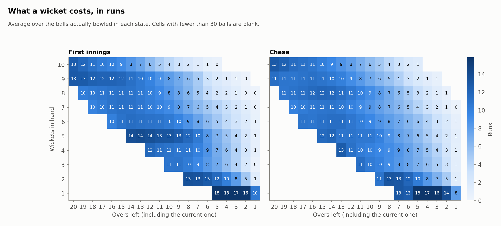
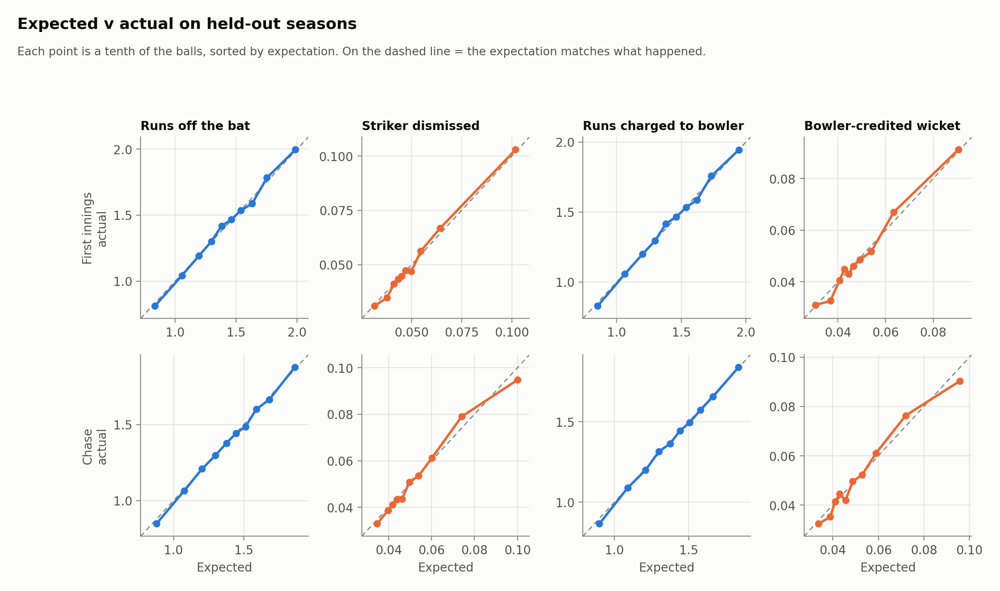
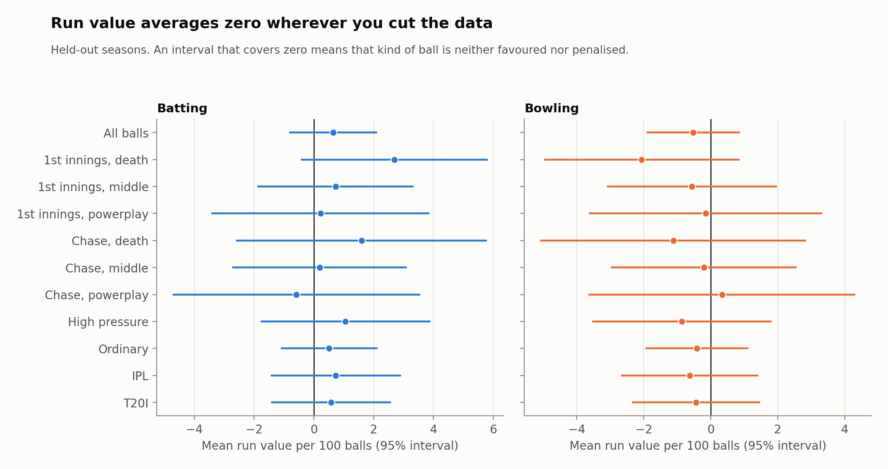
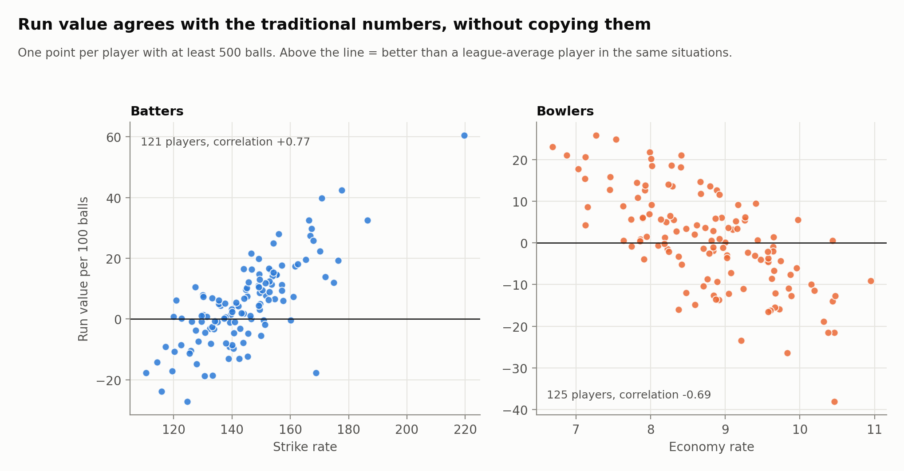

# Phase 3b — Run value: implementation and sanity checks

Every number below comes from `python -m src.pipeline` (tables in `outputs/tables/phase3/`, figures in `outputs/figures/phase3/`, one row per ball in `outputs/ball_value.csv`). Scope: 193,501 scored balls from 837 IPL and T20I matches.

**Status (updated after your review).** Approved, with the wicket cost calibrated to the runs actually lost (option B). §1–§10 are the checkpoint as you reviewed it, before calibration. **§11 is the addendum with the calibration and the final numbers**; where they differ, §11 is current. All numbers in §11 come from a fresh `python -m src.pipeline --force` run, and all 46 tests pass.

**Era adjustment.** Expectations are rescaled so that run value is zero-mean within each competition-season (§2, change 2). A player is measured against the league of the season and competition they played in. This is the project's era adjustment.

## 1. What was built

For every ball, one number per player, in runs:

- **Batting:** `v = (runs off the bat − expected) − c × (dismissed − expected chance)`
- **Bowling:** `v = (expected runs charged − runs charged) + c × (wicket − expected chance)`

`c` is the cost of a wicket in runs for that match state. "Expected" is what a league-average player does in the same situation, from models that never saw the ball's season. Positive is good for the player. Leverage is not in `v`.

## 2. What differs from the proposal

| # | Change | Why | Needs your confirmation? |
|---|---|---|---|
| 1 | **Non-striker run-outs are charged to the dismissed batter** as a wicket cost, with no ball faced. | Your decision. To keep the league average at zero, every ball also carries the small expected run-out risk for the batter at the other end (a fifth expectation, `xw_ns`). | No |
| 2 | **Expectations are rescaled so each season and competition matches its actual totals.** | Tree models cannot extrapolate. IPL 2026 scored faster than any season the 2026 models were trained on, so they under-predicted it: batting value was +4.9 per 100 balls in 2026 and −1.9 in 2022. Ten level factors (0.96 to 1.05 for runs) remove the drift and leave the shape across match states untouched (§4). | **Yes** |
| 3 | **Simpler model settings than my first attempt.** | The first settings were over-confident at the extremes. I compared five settings on held-out seasons and chose the best-calibrated: 150 small trees for runs, 100 very small trees for wickets. | No |
| 4 | **On the last ball of an innings a wicket costs nothing** beyond the dot ball (`c = 0`). | There are no future balls for the wicket to affect. | No |
| 5 | **Fallback for settled matches** is the typical first-innings cost for the same overs left and wickets in hand. | Your proposal (a smoothed `c` by balls left × wickets in hand). I built it from first innings because there is no target there, so the cost reflects only the batting resources a wicket removes. | Part of the `c` review |

## 3. The wicket exchange rate (for your review)

`c = (win probability lost if a wicket falls) ÷ (win probability one run is worth)`, both read from the DP one ball on from the state.

### 3.1 Representative states (IPL 2024 conditions)

| State | Win probability | WP lost to a wicket | WP per run | **Wicket cost (runs)** | Rule |
|---|---|---|---|---|---|
| Chase, early: need 180 off 114, 10 in hand | 69% | 16.5 pts | 0.83 pts | **19.8** | ratio |
| Chase, early: need 180 off 114, 8 in hand | 35% | 15.8 pts | 0.97 pts | **16.3** | ratio |
| Chase, middle: need 90 off 60, 7 in hand | 70% | 12.7 pts | 1.83 pts | **6.9** | ratio |
| Chase, middle: need 90 off 60, 4 in hand | 18% | 10.9 pts | 1.27 pts | **8.5** | ratio |
| Chase, last 2 overs: need 20 off 12, 6 in hand | 81% | 5.3 pts | 3.32 pts | **1.6** | ratio |
| Chase, last 2 overs: need 20 off 12, 2 in hand | 38% | 16.7 pts | 4.33 pts | **3.9** | ratio |
| Chase, last 2 overs: need 20 off 12, last pair | 19% | 15.5 pts | 2.96 pts | **5.2** | ratio |
| Chase, last over: need 8 off 6, 5 in hand | 86% | 4.7 pts | 5.07 pts | **0.9** | ratio |
| Chase, last over: need 5 off 2, 5 in hand | 58% | 3.8 pts | 0.96 pts | **3.9** | ratio |
| Chase, last ball: need 3 off 1 | 45% | 0 | – | **0.0** | last ball |
| Chase, settled (lost): need 60 off 12, 2 in hand | 0% | 0 | 0 | **3.7** | fallback |
| Chase, settled (won): need 5 off 30, 8 in hand | 100% | 0 | 0 | **2.0** | fallback |
| First innings: 10 for 0 after 1 over | 48% | 10.7 pts | 0.63 pts | **16.9** | ratio |
| First innings: 50 for 2 after 6 overs | 34% | 7.2 pts | 0.65 pts | **11.0** | ratio |
| First innings: 50 for 5 after 8 overs | 11% | 4.7 pts | 0.34 pts | **13.9** | ratio |
| First innings: 90 for 3 after 12 overs | 29% | 3.9 pts | 0.64 pts | **6.2** | ratio |
| First innings: 150 for 4 after 17 overs | 39% | 1.9 pts | 0.79 pts | **2.3** | ratio |
| First innings: 150 for 8 after 17 overs | 28% | 4.3 pts | 0.62 pts | **6.9** | ratio |
| First innings: 180 for 5, last over | 44% | 1.1 pts | 0.91 pts | **1.2** | ratio |
| First innings: 180 for 5, last ball | 35% | 0 | 0.86 pts | **0.0** | last ball |

### 3.2 The whole surface

What matches cricket logic:

- **A wicket costs less as the innings runs out.** About 10–12 runs with 15 overs left, 3–7 with 6 left, 0–2 in the last two overs (more if only one or two wickets remain), zero on the last ball.
- **It costs more when few wickets remain.** 150 for 8 after 17 overs: 6.9 runs. 150 for 4: 2.3. With the last pair in, up to 19 runs.
- **A collapse makes the next wicket dearer.** 50 for 5 after 8 overs: 13.9 runs, against 11.0 at 50 for 2 after 6.
- **Chase and first innings agree** where the chase is still open, which they should.

What looks odd:

- **Early overs are high: 15–20 runs** for a wicket in the first three overs.
- **Need 5 off 2 costs 3.9 runs**, more than need 8 off 6 (0.9). When a side needs a six, one extra run is worth very little, so the same loss of win probability converts into more runs. The sum is right; it reads strangely.

### 3.3 An independent check: runs actually lost after a wicket

For every first-innings ball on which a wicket fell, I compared the runs the side went on to add with the average added after a non-wicket ball in the same over with the same wickets in hand. This uses no model.

| Overs left | Wickets | Model's cost | Runs actually lost | Difference |
|---|---|---|---|---|
| All | 5,165 | **7.20** | **7.19** ± 0.30 | +0.01 |
| 16–20 | 1,047 | 14.36 | 11.14 ± 1.05 | **+3.22** |
| 11–15 | 964 | 10.07 | 10.64 ± 0.84 | −0.57 |
| 6–10 | 1,208 | 6.57 | 7.54 ± 0.52 | −0.97 |
| 3–5 | 861 | 3.47 | 4.17 ± 0.38 | −0.70 |
| 1–2 | 1,085 | 1.41 | 2.30 ± 0.16 | **−0.90** |

- **On average the model is right**: 7.20 against 7.19 runs.
- **Its slope is too steep.** It is about 30% high in the first five overs and about 0.9 runs low in the last two. Both gaps are statistically clear (3 and 6 standard errors).
- A likely cause for the early gap: sides that are several wickets down early are often weaker sides or on harder pitches, and the model reads all of that as the effect of the wickets.

### 3.4 How often each rule applies

| | All balls | First innings | Chase | High-pressure balls |
|---|---|---|---|---|
| Ratio | 92.9% | 99.1% | 85.9% | 97.7% |
| Fallback (settled match) | 5.6% | 0.1% | 11.8% | 0.1% |
| Capped | 0.9% | 0.0% | 2.0% | 0.8% |
| Last ball (cost zero) | 0.6% | 0.8% | 0.3% | 1.4% |

- **Settled threshold:** a run worth less than 0.05 percentage points of win probability. Half the fallback balls have a win probability of about 0.1% or less, and a quarter have 99.8% or more.
- **Cap:** 21.3 runs, the 99th percentile of the ratios. The capped balls are almost all the first two overs of large chases.
- **Mean cost:** 8.8 runs (median 8.7).

### 3.5 Options for the early-overs gap

| Option | What it does | My view |
|---|---|---|
| A. Keep as is | Uses the DP ratio with the 21.3-run cap | Simple, right on average, but over-charges powerplay dismissals by about 3 runs each |
| **B. Calibrate to the evidence** | One factor per overs-left band so the model's average matches the runs actually lost (0.78 for overs 16–20 left, up to 1.64 for the last two) | **Recommended.** It is the same idea as the recalibration of the DP itself: keep the model's structure, correct its level against what happened |
| C. Lower the cap | Cap at about 12 runs | Fixes the early overs but also cuts genuine last-pair costs |

The choice mainly affects powerplay batters who get out often and powerplay bowlers who take wickets. For most players it is second-order.

## 4. Your conditions on the expectation models

**Same features for batting and bowling.** One shared list in `src/models/expected.py`: balls remaining, wickets in hand, powerplay flag, balls already faced by the striker, free-hit flag, scoring environment, IPL flag, associate flag. First innings adds score against environment pace.

**Chase state is in the features.** The chase models add runs required and required rate relative to the environment.

**No feature can identify a match.**

| Feature | Constant within a match? | Distinct values | Fewest matches sharing a value | Verdict |
|---|---|---|---|---|
| Scoring environment | Yes | 10 | 66 | Safe: a season-level value |
| IPL flag | Yes | 2 | 367 | Safe |
| Associate flag | Yes | 2 | 53 | Safe |
| The other eight | No | – | – | Safe: they change ball by ball and describe the state |

**Held-out accuracy** (trained without the ball's season; lower is better):

| Expectation | Measure | Season × phase average | Model without "balls faced" and "free hit" | Full model |
|---|---|---|---|---|
| Runs off the bat | Squared error | 3.034 | 2.979 | **2.949** |
| Striker dismissed | Log-loss | 0.2045 | 0.2029 | **0.2028** |
| Non-striker dismissed | Log-loss | 0.0099 | 0.0095 | **0.0095** |
| Runs charged to bowler | Squared error | 2.948 | 2.898 | **2.871** |
| Bowler-credited wicket | Log-loss | 0.2001 | 0.1988 | **0.1987** |

- All five beat the traditional season × phase average.
- **"Balls faced" and "free hit" matter for runs** (2.979 to 2.949) and add almost nothing for wickets.
- The gains are small in absolute terms because a single ball is mostly luck. What matters is that the average is right in every kind of situation.

**Held-out calibration:**

- The largest gap in any tenth is 0.04 runs (runs models) and 0.6 percentage points (wicket models).
- Across the 60 cells of innings × phase × pressure flag × expectation, 2 are more than two standard errors from zero. Chance alone would give about 3.

**Season level (change 2 in §2).** Mean batting value per 100 balls by season:

| | 2022 | 2023 | 2024 | 2025 | 2026 |
|---|---|---|---|---|---|
| Before rescaling | −1.9 | −1.2 | −0.5 | +2.0 | **+4.9** |
| After rescaling | +0.5 | +0.9 | +0.4 | +1.3 | −0.4 |

Without the rescaling, anyone who played mostly in 2026 would gain about 5 runs per 100 balls for nothing.

## 5. League-level sanity checks

### 5.1 Run value averages zero

| Slice | Batting, per 100 balls | Bowling, per 100 balls |
|---|---|---|
| All balls | +0.6 ± 0.8 | −0.5 ± 0.7 |
| First innings | +0.9 ± 0.9 | −0.7 ± 0.9 |
| Chase | +0.2 ± 1.2 | −0.2 ± 1.1 |
| Powerplay | −0.2 ± 1.6 | +0.1 ± 1.5 |
| Middle overs | +0.4 ± 1.0 | −0.4 ± 0.9 |
| Death overs | +2.0 ± 1.3 | −1.6 ± 1.2 |
| IPL | +0.7 ± 1.2 | −0.6 ± 1.1 |
| T20I | +0.5 ± 1.0 | −0.4 ± 1.0 |
| **Ordinary balls** | **+0.5 ± 0.8** | **−0.4 ± 0.8** |
| **High-pressure balls** | **+0.9 ± 1.5** | **−0.8 ± 1.4** |

Standard errors treat matches, not balls, as independent. No slice is more than 1.6 standard errors from zero. Death overs are the furthest, at about +2 for batters.

### 5.2 The raw pressure gap is gone

| | Ordinary | High pressure | Gap |
|---|---|---|---|
| Batters: raw strike rate | 138.3 | 145.1 | +6.7 |
| Batters: run value per 100 balls | +0.5 | +0.9 | +0.5 ± 1.7 |
| Bowlers: raw runs conceded per 100 balls | 138.0 | 144.5 | +6.4 |
| Bowlers: run value per 100 balls | −0.4 | −0.8 | −0.4 ± 1.6 |

This is the requirement you set: a player is no longer credited or blamed just for being in a high-pressure situation.

### 5.3 Where the ball-to-ball noise comes from

| Standard deviation of batting value on one ball | Runs part | Wicket part | Total |
|---|---|---|---|
| Powerplay | 1.8 | 2.8–3.0 | 3.6–3.7 |
| Middle overs | 1.6 | 1.7–1.8 | 2.5–2.6 |
| Death overs | 1.8 | 0.9–1.4 | 2.2–2.5 |

In the powerplay most of the noise is the wicket term, because wickets are dear there. Option B in §3.5 would reduce it.

## 6. Does it make cricket sense?

### 6.1 Agreement with traditional numbers

Players with at least 500 balls (121 batters, 125 bowlers).

| | Correlation with run value per 100 balls |
|---|---|
| Batters: strike rate | +0.76 |
| Batters: average | +0.51 |
| Bowlers: economy rate | −0.68 |
| Bowlers: balls per wicket | −0.37 |

Run value moves with both the scoring-rate number and the wicket number, and is identical to neither. That is what a combined measure should do.

### 6.2 Top and bottom 10 on OVERALL value (all balls, no pressure layer)

At least 500 balls. Value is runs per 100 balls against a league-average player in the same situations. Names are as they appear in the ball data; the tables in `outputs/tables/phase3/` carry `player_id` and teams.

**Batters**

| # | Top 10 | Balls | SR | Avg | Value / 100 | | Bottom 10 | Balls | SR | Avg | Value / 100 |
|---|---|---|---|---|---|---|---|---|---|---|---|
| 1 | Vaibhav Sooryavanshi | 578 | 220 | 41.0 | **+62.1** | | Wriddhiman Saha | 661 | 125 | 23.5 | **−27.8** |
| 2 | Tim David | 1,226 | 178 | 34.6 | +41.2 | | Sediqullah Atal | 529 | 116 | 21.9 | −23.1 |
| 3 | Andre Russell | 714 | 171 | 27.1 | +38.0 | | Parvez Emon | 517 | 133 | 20.3 | −21.9 |
| 4 | Abhishek Sharma | 2,251 | 186 | 33.3 | +33.1 | | Rahmanullah Gurbaz | 1,107 | 131 | 21.6 | −21.6 |
| 5 | Suryakumar Yadav | 2,749 | 166 | 38.8 | +32.4 | | Sunil Narine | 509 | 169 | 20.0 | −18.1 |
| 6 | Dinesh Karthik | 639 | 167 | 28.1 | +29.3 | | Kane Williamson | 535 | 110 | 28.1 | −17.2 |
| 7 | Rajat Patidar | 918 | 168 | 35.0 | +27.1 | | Andrew Balbirnie | 569 | 120 | 23.4 | −16.2 |
| 8 | Rashid Khan | 507 | 156 | 18.0 | +27.0 | | Krunal Pandya | 656 | 128 | 24.0 | −14.9 |
| 9 | Heinrich Klaasen | 1,417 | 167 | 39.4 | +26.7 | | Rachin Ravindra | 582 | 142 | 22.4 | −14.8 |
| 10 | Reeza Hendricks | 835 | 147 | 36.0 | +23.7 | | Devdutt Padikkal | 998 | 139 | 24.3 | −12.8 |

**Bowlers**

| # | Top 10 | Balls | Econ | Balls/wkt | Value / 100 | | Bottom 10 | Balls | Econ | Balls/wkt | Value / 100 |
|---|---|---|---|---|---|---|---|---|---|---|---|
| 1 | Blessing Muzarabani | 846 | 7.5 | 17.8 | **+26.5** | | Shahbaz Ahmed | 554 | 10.5 | 29.7 | **−39.1** |
| 2 | Jasprit Bumrah | 1,780 | 7.3 | 20.1 | +24.9 | | Matt Henry | 636 | 9.2 | 23.0 | −26.7 |
| 3 | Abrar Ahmed | 776 | 6.7 | 16.6 | +23.4 | | Chris Jordan | 574 | 9.8 | 28.9 | −25.6 |
| 4 | Mohsin Khan | 678 | 8.4 | 17.2 | +22.2 | | Nitish Reddy | 595 | 10.4 | 20.9 | −22.3 |
| 5 | Josh Hazlewood | 1,515 | 8.3 | 15.1 | +20.4 | | Romario Shepherd | 1,657 | 10.5 | 18.1 | −21.9 |
| 6 | Varun Chakravarthy | 2,182 | 8.0 | 15.8 | +20.4 | | Anrich Nortje | 878 | 10.3 | 23.2 | −18.5 |
| 7 | Sunil Narine | 1,553 | 6.9 | 23.9 | +19.8 | | Sam Curran | 1,405 | 9.6 | 21.8 | −17.6 |
| 8 | Mohammad Nawaz | 1,017 | 7.1 | 15.2 | +19.7 | | Mohammad Nabi | 693 | 8.4 | 23.4 | −17.2 |
| 9 | Noor Ahmad | 1,537 | 8.0 | 17.3 | +19.6 | | Alzarri Joseph | 1,214 | 9.7 | 19.9 | −16.8 |
| 10 | Mahedi Hasan | 910 | 7.1 | 18.5 | +17.8 | | Cameron Green | 799 | 9.6 | 22.1 | −16.8 |

How I read these, from the numbers only:

- **The top batters score fast without getting out cheaply for their role.** Finishers with modest averages (Russell 27, Karthik 28, Rashid Khan 18) rank high because their wickets fall late, when a wicket is cheap. That is the exchange rate working as intended.
- **The bottom batters are mostly slow scorers at the top of the order** (strike rates of 110–133), where balls and wickets are both expensive.
- **One case to look at: Sunil Narine as a batter** (strike rate 169, average 20, value −18). His runs part is +16 per 100 balls and his wicket part −34. *(Corrected in §11.3: I said his dismissals fall mostly in the first overs. They do not; most of the damage is in the middle overs, and option B barely moves him.)*
- **The top bowlers get there by different routes.** Bumrah and Narine rank high almost entirely on runs saved (+31 and +28 per 100 balls from the runs part; their wicket part is slightly negative). Hazlewood and Mohsin Khan have ordinary-looking economy rates (8.3 and 8.4) that are still better than expected for the overs they bowl, and their wickets add as much again.
- **Opposition quality is not yet in.** Muzarabani, Abrar Ahmed, Nawaz and Mahedi Hasan play mostly bilateral T20Is, some against weaker batting sides. That is the Phase 4 adjustment.

### 6.3 Companion metric: win probability added

| | Batters | Bowlers |
|---|---|---|
| Mean WPA per ball (percentage points) | −0.009 | +0.009 |
| Correlation of a player's total WPA with their LI-weighted run value | 0.96 | 0.94 |
| …with their unweighted run value | 0.90 | 0.86 |

- WPA averages zero, as it should.
- **WPA tracks LI-weighted run value almost exactly (0.94–0.96).** This confirms the relationship in the proposal: WPA is run value with leverage already multiplied in. It is why WPA must never be LI-weighted again, and why LI-weighted run value needs no second pressure adjustment.

## 7. Ready for the pressure layer? Two findings for Phase 5

The split into pressure and ordinary balls is built (`player_pressure_split_*.csv`), but no pressure ranking is shown here, as you asked.

**7.1 Own-baseline matching: phase only.**

| Players with ≥ 200 pressure balls | Matched on phase | Matched on phase × innings |
|---|---|---|
| Batters whose pressure balls are fully covered by their own ordinary balls | 86% | 39% |
| Bowlers, same | 95% | 68% |
| Spread of uplift across batters (SD, per 100 balls) | 18.4 | 25.6 |
| Spread of uplift across bowlers | 20.0 | 28.7 |

Adding innings leaves most players with empty cells and makes uplift noisier. I recommend matching on phase only.

**7.2 Uplift is very noisy. For batters it is close to pure noise.**

| Players with ≥ 200 pressure balls | Typical standard error | Spread across players (SD) | Implied real spread |
|---|---|---|---|
| Batters: usual value | 9.6 | 13.6 | about 10 |
| Batters: pressure value | 15.5 | 16.9 | about 7 |
| **Batters: uplift** | **18.6** | **18.4** | **about 0** |
| Bowlers: usual value | 9.8 | 12.3 | about 7 |
| Bowlers: pressure value | 15.7 | 19.1 | about 11 |
| **Bowlers: uplift** | **18.7** | **20.0** | **about 7** |

All in runs per 100 balls. "Implied real spread" is what is left of the spread after removing what measurement noise alone would produce. It is a rough first estimate (standard errors here are ball-level and unmatched); Phase 5 will do it properly.

- **Players differ in how good they are under pressure** (real spread of about 7–11 runs per 100 balls).
- **They barely differ, measurably, in how much better or worse they are than their own usual level.** For batters the observed spread in uplift is no larger than noise alone would give.
- **Consequence for Phase 5.** A ranking on raw uplift would mostly rank luck. Uplift needs heavy shrinkage, and the rating should lean on pressure value. I will bring the design to you in Phase 5; this is the evidence it has to respect.

## 8. Scoring environment tested on the DP

You asked for this test, with the rule "keep unless it clearly hurts".

| Chosen model (DP + recalibration) | Held-out log-loss |
|---|---|
| With the scoring-environment adjustment | **0.5165** |
| Without it | 0.5222 |

Removing it costs 0.0057, about ten times the effect seen on LightGBM. It clearly helps, so it stays, with era validity as the main justification.

## 9. Limitations at this stage

- The wicket cost is about 30% high in the first five overs and about 0.9 runs low in the last two (§3.3), pending your decision on option B.
- A run is valued as one run wherever it is scored.
- Fielding, and blame for a run-out, cannot be separated: the dismissed batter is charged.
- Free hits are inferred from the previous delivery.
- Opposition quality, venue and role are not yet adjusted for (Phase 4).
- Model settings were chosen from five options on the same held-out seasons used for evaluation. The differences between options were small.

## 10. Decisions needed

| # | Question | My recommendation |
|---|---|---|
| 1 | Wicket cost: approve, and which option for the early-overs gap? | Option B: calibrate by overs-left band to the runs actually lost |
| 2 | Settled threshold (0.05 points of WP per run), first-innings fallback table, cap at the 99th percentile (21.3 runs) | Approve; under option B the cap would apply after calibration |
| 3 | Season rescaling of expectations | Confirm |
| 4 | Own baseline matched on phase only | Confirm |
| 5 | Does the overall top/bottom 10 make enough cricket sense to move on? | Yes, with Narine's batting as the case to re-check after decision 1 |

## 11. Addendum: wicket cost calibrated to the runs actually lost (option B)

### 11.1 How it was done

- **Factor by overs left** = runs actually lost after a wicket ÷ the model's cost, on full-length, unaffected first innings (5,165 wickets).
- **Runs lost** are measured against non-wicket balls in the same state (balls left × wickets in hand; the over is used where a state has fewer than 20 balls).
- **Monotone:** isotonic regression, so the factor can only rise as the innings runs out. **Smooth:** straight lines join the centres of its steps.
- **Cross-fitted by season:** for season Y, both the runs-lost baseline and the factors come from the other four seasons.
- **One set of factors for both innings.** You asked for factors per innings if counts allowed. The obstacle is not counts: in a chase the innings stops at the target, so the runs a wicket can cost are capped by what was still needed, and this measurement does not work. The chase uses the first-innings factors. That is an assumption, stated in the limitations.
- **Cap re-derived** after calibration: 21.3 runs before, **17.9 runs** after (99th percentile of the calibrated ratios).

### 11.2 Result

Factors (all seasons; each season's own cross-fitted factors differ from these by up to about 0.2 in the first and last two overs, and by less elsewhere):

| Overs left | 20–19 | 18 | 17 | 16 | 15 | 14–12 | 11–9 | 8–6 | 5–3 | 2 | 1 |
|---|---|---|---|---|---|---|---|---|---|---|---|
| Factor | 0.77 | 0.77 | 0.78 | 0.84 | 0.95 | 1.01–1.04 | 1.06–1.13 | 1.18–1.23 | 1.24 | 1.24 | 1.58 |

The independent check from §3.3, before and after:

| Overs left | Wickets | Runs actually lost | Model before | Gap before | Model after | Gap after |
|---|---|---|---|---|---|---|
| All | 5,165 | 7.14 ± 0.30 | 7.20 | +0.06 | 7.11 | −0.03 |
| 16–20 | 1,047 | 11.19 ± 1.05 | 14.36 | **+3.18** | 11.46 | +0.28 |
| 11–15 | 964 | 10.61 ± 0.84 | 10.07 | −0.55 | 10.17 | −0.45 |
| 6–10 | 1,208 | 7.58 ± 0.52 | 6.57 | **−1.01** | 7.47 | −0.10 |
| 3–5 | 861 | 4.27 ± 0.37 | 3.47 | **−0.81** | 4.32 | +0.05 |
| 1–2 | 1,085 | 1.94 ± 0.14 | 1.41 | **−0.53** | 2.00 | +0.07 |

(The "runs actually lost" column differs slightly from §3.3 because the baseline now uses the exact ball, not the over.) Every band is now within one standard error.

Representative states after calibration (IPL 2024 conditions):

| State | Before | After |
|---|---|---|
| Chase, early: need 180 off 114, 10 in hand | 19.8 | **15.2** |
| Chase, middle: need 90 off 60, 7 in hand | 6.9 | 7.3 |
| Chase: need 20 off 12, 6 in hand / last pair | 1.6 / 5.2 | 1.9 / 6.3 |
| Chase, last over: need 8 off 6, 5 in hand | 0.9 | 1.5 |
| Chase, last over: need 5 off 2, 5 in hand | 3.9 | 6.5 |
| First innings: 10 for 0 after 1 over | 16.9 | **13.0** |
| First innings: 50 for 2 after 6 overs | 11.0 | 10.6 |
| First innings: 90 for 3 after 12 overs | 6.2 | 6.9 |
| First innings: 150 for 8 after 17 overs | 6.9 | 8.2 |
| Last ball of an innings | 0 | 0 |

One state reads worse: need 5 off 2 now costs 6.5 runs. The calibration multiplies the same small "win probability per run" by 1.6 in the last over. These states are rare and almost all are high-pressure balls, so I will check in Phase 5 whether they move any rating.

### 11.3 Openers, and a premise I need to correct

You expected the fix to remove a systematic opener penalty. It did not, and on reflection it could not:

> Rescaling the wicket cost in a state changes the value of a dismissal **and** the credit for surviving by the same factor. A group of batters who are dismissed exactly as often as expected in that state is unaffected. Only players who are out more, or less, often than expected move.

Mean batting value per 100 balls faced, by batting position:

| Position | 1 | 2 | 3 | 4 | 5 | 6 | 7 | 8 | 9 | 10 | 11 |
|---|---|---|---|---|---|---|---|---|---|---|---|
| Before | −4.5 | −1.0 | −2.5 | +3.9 | +2.3 | +0.9 | +3.7 | −3.2 | −14.6 | −22.0 | +1.5 |
| After | −4.1 | −0.9 | −2.1 | +3.8 | +2.3 | +0.7 | +3.7 | −4.0 | −15.5 | −23.1 | +3.9 |

Where the opener gap does come from (position 1, runs per 100 balls):

| | Powerplay | Middle overs | Death overs |
|---|---|---|---|
| Runs part | +0.5 | **−5.0** | **−6.0** |
| Wicket part | −1.3 | −0.2 | −1.7 |

By balls already faced, position 1's runs part is −0.7 on balls 1–10 and **−4.0 after 25 balls**, against +1.3 for a set number 3 and +4.4 for a set number 4. So openers who are still in after the powerplay score more slowly than other set batters in the same match state. That is a scoring-rate finding, not a pricing error. Whether to adjust for position is in the Phase 4 proposal (§6).

**High-volume openers, before and after** (players with at least 500 balls whose usual position is 1 or 2; all 43 such players moved by −0.35 on average):

| Opener | Balls | SR | Avg | Before | After | Rank before → after (of 121) |
|---|---|---|---|---|---|---|
| Rahmanullah Gurbaz | 1,107 | 131 | 21.6 | −21.6 | **−18.8** | 118 → 119 |
| Sunil Narine (batting) | 509 | 169 | 20.0 | −18.1 | −17.7 | 117 → 116 |
| Quinton de Kock | 1,262 | 151 | 30.7 | −3.0 | −0.4 | 89 → 80 |
| Rohit Sharma | 1,619 | 144 | 27.4 | −8.7 | −7.8 | 102 → 99 |
| Brandon King | 1,135 | 133 | 26.9 | −8.8 | −8.1 | 104 → 101 |
| Jos Buttler | 2,819 | 155 | 41.3 | +15.6 | +14.6 | 20 → 26 |
| Shubman Gill | 2,711 | 149 | 40.5 | +8.8 | +8.7 | 44 → 44 |
| Virat Kohli | 2,456 | 145 | 46.9 | +8.7 | +7.4 | 45 → 47 |
| Abhishek Sharma | 2,251 | 186 | 33.3 | +33.1 | +32.5 | 4 → 4 |
| Sai Sudharsan | 1,686 | 149 | 49.3 | +13.7 | +10.5 | 26 → 38 |
| Phil Salt | 1,608 | 170 | 36.5 | +22.7 | +22.3 | 12 → 11 |
| Travis Head | 1,129 | 175 | 30.4 | +12.6 | +12.1 | 32 → 32 |

- **Gurbaz rises 2.9:** he is out more often than expected in the powerplay, where dismissals are now cheaper.
- **Low-dismissal openers fall slightly** (Sai Sudharsan −3.1, Kohli −1.3): surviving the powerplay is now worth less.
- **Narine barely moves (+0.4).** My §6.2 explanation was wrong. He is dismissed 41 times against 24.7 expected, and most of the cost (−102 of −148 runs from the wicket part) falls in the middle overs, where the calibrated cost is slightly **higher**. His negative value is mainly about being out far more often than expected, not about early-overs pricing.
- **Across all players the change is small:** at most 3.4 runs per 100 balls for anyone, and rank correlation with the old values is 0.995 (batters) and 0.993 (bowlers).

### 11.4 Overall top and bottom 10, after calibration

Changes only (full tables in `overall_top_bottom_*.csv`):

- **Batting top 10:** Romario Shepherd enters at 10 (+25.0), Reeza Hendricks drops to 12 (+21.6). The order within the top 9 shifts slightly; Sooryavanshi, Tim David and Russell stay 1–3.
- **Batting bottom 10:** Nazmul Hossain Shanto enters (−14.3), Devdutt Padikkal leaves (−13.0).
- **Bowling top 10:** Bumrah moves to 1 (+25.8) and Muzarabani to 2 (+24.9). Kuldeep Yadav enters at 10 (+18.4); Mahedi Hasan drops to 14 (+15.4).
- **Bowling bottom 10:** the same ten players; Matt Henry improves from −26.7 to −23.5.

Romario Shepherd is now in the batting top 10 and the bowling bottom 10. Both come from different balls, so there is no contradiction, but he is worth watching after the Phase 4 opposition adjustment.

### 11.5 Uplift reliability, bowlers included

As you asked, the same test (observed spread across players against measurement noise) for both roles, after calibration. Runs per 100 balls:

| | Min pressure balls | Players | Typical standard error | Observed spread | Implied real spread |
|---|---|---|---|---|---|
| Batters: uplift | 100 / 200 / 300 | 142 / 74 / 30 | 23.1 / 18.3 / 15.1 | 38.3 / 16.9 / 15.2 | 24.7 / **0.0** / 2.0 |
| Bowlers: uplift | 100 / 200 / 300 | 149 / 80 / 46 | 21.7 / 18.3 / 15.9 | 21.9 / 19.2 / 14.9 | **0.0** / 5.6 / **0.0** |
| Batters: pressure value | 100 / 200 / 300 | | 19.0 / 15.4 / 12.7 | 24.3 / 16.2 / 14.2 | 12.8 / 0.6 / 6.4 |
| Bowlers: pressure value | 100 / 200 / 300 | | 18.0 / 15.1 / 13.5 | 20.7 / 18.8 / 16.3 | 7.7 / 10.7 / 8.6 |

- **Bowler uplift is close to noise too.** At 100 and 300 pressure balls its observed spread is no larger than its noise; only the 200 cut shows a small real spread (5.6).
- **The batters' ≥ 100 figure (24.7) is inflated** by players with few balls whose standard errors are themselves imprecise; the ≥ 200 and ≥ 300 rows are the trustworthy ones.
- **Bowler pressure value has a stable real spread of about 8–11.** Batter pressure value jumps between 0.6 and 12.8 depending on the cut, so it cannot be judged from this test; the split-half test in Phase 5 will settle it.
- These are ball-level standard errors. Match-level ones (Phase 5) will be somewhat larger, which would lower every implied real spread.

### 11.6 Updated limitations

- The wicket-cost calibration is measured on first innings and applied to chases (§11.1).
- In the last over the calibration factor (1.24–1.58) makes some chase states expensive (need 5 off 2: 6.5 runs).
- The opener gap in the runs part (§11.3) is not adjusted for; see the Phase 4 proposal.
