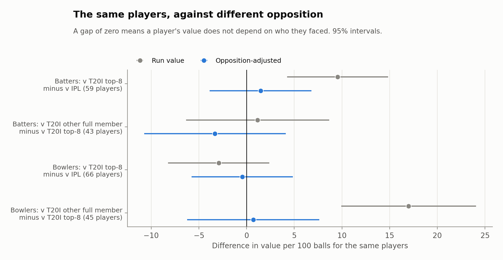

# Phase 4b — Fair comparisons: implementation and evidence

Every number below comes from `python -m src.pipeline` (tables in `outputs/tables/phase4/`, figure in `outputs/figures/phase4/`, adjusted values per ball in `outputs/ball_value_adjusted.csv`). All 50 tests pass.

## 1. What was built

- **A "who faced whom" ridge model** over every ball, one fit for batting value and one for bowling value. Each ball's value is explained by:
  - the **opponent tier** on that ball (IPL, T20I top-8, other full member, associate), not penalised;
  - each player's **home group** (their T20I tier, or "IPL only"), not penalised, so players are shrunk towards their own group's level;
  - **individual batter and bowler effects**, penalised; the penalty is chosen by cross-validation on held-out matches.
- **A per-ball adjustment.** Each player's adjusted value adds back what the opponent on that ball (tier, group and individual) is worth. The player's own rating is still built from their own balls, and shrunk once, in Phase 5.
- **Eligibility** for every player and role.

## 2. One addition to what you approved

| Change | Why | Needs your confirmation? |
|---|---|---|
| **Each T20I tier is split into players who also play in the IPL and players who do not** (for example "T20I top-8 (also IPL)" and "T20I top-8"). | With your four tiers alone, the batters' gap closed by only 36% (9.5 to 6.1). The top-8 group mixed IPL-linked players with many T20I-only players (Pakistan's, for example). Those are the weaker group, and because the group effect is shared, they dragged down the level of the IPL-linked players, who are the ones that carry the IPL-T20I comparison. Splitting the group lets each part have its own level. | **Yes** |

The split also predicts better on held-out matches (§4), so it is not tuned to pass the acceptance test alone.

## 3. Acceptance test: the same-player gaps

Same players, at least 150 balls against each tier. Value per 100 balls:

| Same players | Comparison | Before | After | Closed |
|---|---|---|---|---|
| 59 batters | v T20I top-8, minus v IPL | **+9.5** ± 2.7 | **+1.5** ± 2.7 | 85% |
| 43 batters | v other full members, minus v top-8 | +1.2 ± 3.8 | −3.3 ± 3.8 | overshoots, within one standard error: a possible slight overcorrection (the model may slightly overrate those four sides' bowling) |
| 66 bowlers | v T20I top-8, minus v IPL | −2.9 ± 2.7 | −0.5 ± 2.7 | 84% |
| 45 bowlers | v other full members, minus v top-8 | **+17.0** ± 3.6 | **+0.7** ± 3.5 | 96% |

- **Both large gaps close.** The adjusted gaps are all within about one standard error of zero.
- **An honest caveat.** This test uses the same balls the model was fitted on. It shows that the model's structure removes the dependence on opposition; the independent evidence that the model generalises is the held-out prediction in §4.
- Associates: too few same-player comparisons (one batter, no bowler) to test.

## 4. Held-out prediction and the penalty

Mean squared error of ball value on held-out matches (5 folds; whole matches held out):

| Model | Batting value | Bowling value |
|---|---|---|
| League average only | 7.6432 | 7.5920 |
| Tiers and groups, no player effects | 7.6360 | 7.5848 |
| **Full model, penalty 1,000 (chosen)** | **7.6299** | **7.5791** |
| Penalty 300 / 3,000 | 7.6318 / 7.6317 | 7.5811 / 7.5808 |
| Penalty 30 (too little shrinkage) | 7.6509 | 7.5998 |

- **The chosen penalty is 1,000 balls** for both roles. In plain terms: a player with 1,000 balls is pulled halfway towards their group's level when the model estimates them as an opponent.
- **The gains look tiny (0.2%) and that is expected.** A single ball is mostly luck (its standard deviation is about 2.8 runs), so even a perfect knowledge of player skill would reduce this error only slightly. What matters is the direction: tiers help, groups help, and individual effects help further, all on matches the model did not see.
- With too little shrinkage (penalty 30) the model is worse than the league average: individual effects fitted to small samples are mostly noise.

## 5. What the model learned (runs per 100 balls, relative to the IPL)

**Opposition tiers.** How much easier a ball is for the batter (batting fit), or for the bowler (bowling fit), than an IPL ball, before the opponent's own group and individual effect:

| Opposition tier | Batting | Bowling |
|---|---|---|
| T20I top-8 | +5.7 | −5.5 |
| T20I other full member | +6.2 | −8.2 |
| T20I associate | +9.4 | +5.6 |

These are environment effects only; the opponents' group effects add to them. For example, bowling at the four other full members' T20I-only batters is easier still (their batting group is −16.0 in the batting fit).

**Mean value after adjustment, by competition:**

| | Batting, raw | Batting, adjusted | Bowling, raw | Bowling, adjusted |
|---|---|---|---|---|
| IPL | −0.6 | **+5.1** | −0.6 | **+2.0** |
| T20I | −1.0 | **−5.6** | −0.4 | **−2.6** |

On the common scale, an average IPL performance is worth about 10.7 runs per 100 balls more than an average T20I performance for batters, and about 4.6 more for bowlers. That matches the same-player evidence in the Phase 4 proposal (11.6 and 4.1).

**Batting position is unchanged** by the adjustment (position 1: −4.05 raw, −4.06 adjusted; position 4: +3.79, +3.85). The opener gap is not an opposition effect.

## 6. Your test cases

Bowlers, at least 500 balls (125 players). Value per 100 balls:

| Bowler | Raw | Adjusted | Rank before → after | Share of balls in IPL / v top-8 |
|---|---|---|---|---|
| Jasprit Bumrah (contrast) | +25.8 | +27.3 | 1 → 1 | 71% / 20% |
| **Blessing Muzarabani** | +24.9 | +20.8 | **2 → 8** | 5% / 43% |
| **Mohammad Nawaz** | +20.6 | +18.7 | **7 → 12** | 0% / 66% |
| **Mahedi Hasan** | +15.4 | +7.4 | **14 → 39** | 0% / 59% |
| Alzarri Joseph | −15.9 | −10.2 | 116 → 105 | 33% / 59% |
| Sam Curran | −16.2 | −13.0 | 118 → 111 | 43% / 51% |
| Anrich Nortje | −18.9 | −14.4 | 120 → 112 | 69% / 31% |
| Romario Shepherd | −21.5 | −19.0 | 121 → 119 | 23% / 64% |
| Chris Jordan | −26.4 | −22.8 | 124 → 124 | 38% / 56% |

- **The three you flagged all fall**, Mahedi Hasan most (he loses 8 runs per 100 balls).
- **The five death bowlers all rise**, by 2.5 to 5.6, but **remain in the bottom fifth** (ranks 105–124 of 125). Their poor numbers are not mainly about the opposition they faced. Whether they are about the death overs (the hardest phase to bowl) is a role question for Phase 6, alongside the batting-position check.

## 7. Who moves most

Across players with at least 500 balls, the adjustment has a standard deviation of about 4 runs per 100 balls (batters 4.2, bowlers 3.7); rank correlation with the raw values is 0.95 (batters) and 0.94 (bowlers).

| Biggest falls | Change | | Biggest rises | Change |
|---|---|---|---|---|
| **Batters** | | | | |
| Liton Das | −8.5 | | Shashank Singh | +7.1 |
| Curtis Campher | −7.7 | | Riyan Parag | +6.5 |
| Sediqullah Atal | −7.6 | | Nehal Wadhera | +6.4 |
| Tanzid Hasan | −7.2 | | Ayush Badoni | +6.2 |
| Parvez Emon | −6.9 | | Prabhsimran Singh | +6.0 |
| **Bowlers** | | | | |
| Gareth Delany | −9.8 | | Liam Livingstone | +7.3 |
| Mark Adair | −8.7 | | Andre Russell | +5.7 |
| Mahedi Hasan | −8.0 | | Alzarri Joseph | +5.6 |
| Mujeeb Ur Rahman | −7.7 | | Marco Jansen | +5.6 |
| Barry McCarthy | −7.6 | | Keshav Maharaj | +5.1 |

The pattern is consistent: players who play mostly bilateral T20Is involving Bangladesh, Ireland, Afghanistan or Zimbabwe fall; players who play mostly IPL (including uncapped Indian players with no T20Is) rise.

## 8. Overall top and bottom 10 after adjustment (still no pressure layer)

At least 500 balls; value per 100 balls. Rank before adjustment in brackets.

| # | Batters | Adjusted | | Bowlers | Adjusted |
|---|---|---|---|---|---|
| 1 | Vaibhav Sooryavanshi (1) | +65.1 | | Jasprit Bumrah (1) | +27.3 |
| 2 | Tim David (2) | +44.5 | | Varun Chakravarthy (4) | +25.2 |
| 3 | Andre Russell (3) | +43.7 | | Sunil Narine (5) | +24.8 |
| 4 | Abhishek Sharma (4) | +34.6 | | Mohsin Khan (6) | +24.2 |
| 5 | Suryakumar Yadav (5) | +33.9 | | Josh Hazlewood (9) | +21.7 |
| 6 | Heinrich Klaasen (8) | +33.3 | | Noor Ahmad (8) | +21.4 |
| 7 | Dinesh Karthik (6) | +32.6 | | Kuldeep Yadav (10) | +21.1 |
| 8 | Rajat Patidar (9) | +31.8 | | Blessing Muzarabani (2) | +20.8 |
| 9 | Rashid Khan (7) | +27.7 | | Piyush Chawla (11) | +19.5 |
| 10 | Shashank Singh (18) | +24.5 | | Abrar Ahmed (3) | +19.4 |

| # | Bottom batters | Adjusted | | Bottom bowlers | Adjusted |
|---|---|---|---|---|---|
| 1 | Sediqullah Atal (120) | −31.4 | | Shahbaz Ahmed (125) | −36.1 |
| 2 | Parvez Emon (118) | −25.5 | | Chris Jordan (124) | −22.8 |
| 3 | Rahmanullah Gurbaz (119) | −23.0 | | Mohammad Nabi (117) | −22.2 |
| 4 | Wriddhiman Saha (121) | −21.5 | | Nitish Reddy (122) | −20.6 |
| 5 | Andrew Balbirnie (115) | −20.9 | | Matt Henry (123) | −20.2 |
| 6 | Nazmul Hossain Shanto (113) | −19.4 | | Dasun Shanaka (112) | −19.1 |
| 7 | Kane Williamson (117) | −17.4 | | Romario Shepherd (121) | −19.0 |
| 8 | Lorcan Tucker (107) | −16.0 | | Tanzim Sakib (108) | −18.5 |
| 9 | Ibrahim Zadran (105) | −15.6 | | Mohammad Rishad Hossain (105) | −18.1 |
| 10 | Paul Stirling (106) | −15.4 | | Barry McCarthy (101) | −18.0 |

## 9. Eligibility

At least 100 pressure balls in at least 10 matches:

| | Eligible | Below the bar: too few pressure balls | Below the bar: pressure balls in too few matches |
|---|---|---|---|
| Batters | **137** | 682 | 5 |
| Bowlers | **139** | 447 | 10 |

The 10-match condition removes 5 batters and 10 bowlers who reach 100 pressure balls in a handful of matches. The full list, with each player's status and reason, is `eligibility.csv`. When you send the Unstop spellings, I will mark any dropdown player who falls below the bar.

## 10. Limitations

- **One rating per player across 2022–26.** Players change over time (form, age, role); a single rating describes the whole period. A recency check is a candidate for Phase 6.
- The same-player test uses the balls the model was fitted on (§3); held-out prediction is the out-of-sample evidence.
- Associate opposition is too rare (4% of balls) for its effect to be tested on the same players.
- The non-striker's run-out value is not adjusted (no bowler skill is involved).
- Groups are fixed per player (their main T20I tier); a player who changes country is assigned their main one.

## 11. Decisions needed

| # | Question | My recommendation |
|---|---|---|
| 1 | Split each T20I tier by IPL participation (§2) | Approve |
| 2 | Accept the acceptance test as passed (85–96% closed, all adjusted gaps within about one standard error) | Yes |
| 3 | Death bowlers rise but stay in the bottom fifth | Accept for now; role check in Phase 6 |
