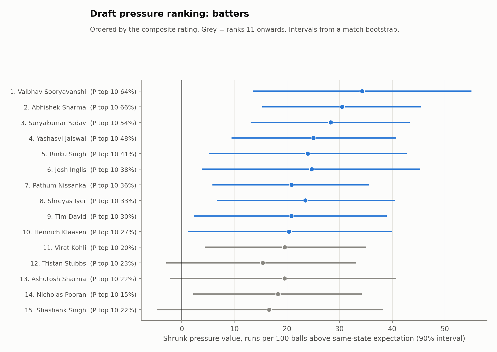
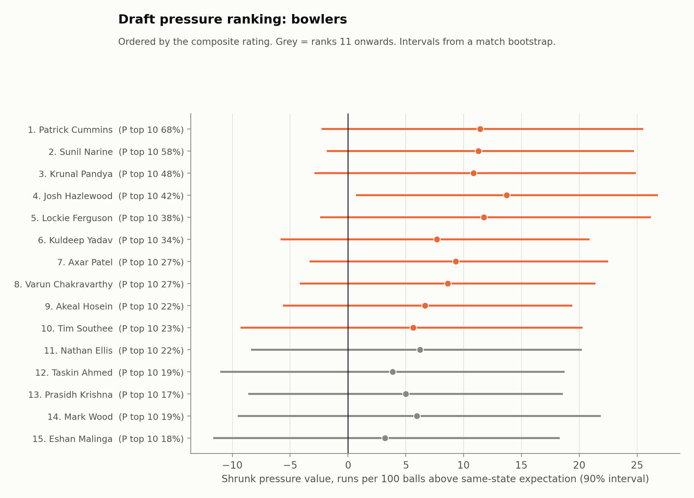

# Phase 5b — Ratings and draft rankings: checkpoint

Every number below comes from `python -m src.pipeline` (tables in `outputs/tables/phase5/`, figures in `outputs/figures/phase5/`). All 56 tests pass. This run reused the cached models from Phases 2–3; the fresh end-to-end `--force` run is scheduled before Phase 7, as you asked.

## 1. Summary

- **Leverage weight: uniform** within pressure balls. All three options are equally reproducible, so the simplest wins (§4).
- **Split-half reliability** of pressure value is 0.33 for batters and 0.19 for bowlers. **Uplift's reliability is zero for both roles**, so it gets no weight. Consistency adds a little (0.08 batters, 0.15 bowlers).
- **The ranking is uncertain, and the report shows how uncertain.** The top players have a 60–80% chance of being in the top 10; places 8–12 are close calls.
- **The pressure top 10 differs a lot from the overall top 10:** 5 batters and 6 bowlers change. Part of that is real, and part is the low reliability of pressure-only data (§9).
- **Two technical fixes need your confirmation** (§3): pooled standard errors, and a correction to the bootstrap.

## 2. Phase 4 follow-ups

### 2.1 Does the IPL split of the tiers push strong T20I-only players down?

Opposition-adjusted value per 100 balls with and without the split, for the 12 highest-volume T20I-only players per role and the four you named (`tier_split_check_t20i_only.csv`):

| T20I-only player | Balls | Without split | With split | Change | Rank (of ~125, ≥500 balls) |
|---|---|---|---|---|---|
| Babar Azam (bat) | 1,181 | +4.7 | +1.8 | −2.9 | 61 → 75 |
| Mohammad Rizwan (bat) | 1,152 | +8.0 | +5.2 | −2.7 | 48 → 63 |
| Reeza Hendricks (bat) | 835 | +19.4 | +17.0 | −2.4 | 17 → 26 |
| Mark Chapman (bat) | 868 | +9.4 | +6.4 | −3.1 | 45 → 57 |
| Ibrahim Zadran (bat) | 1,126 | −12.2 | −15.6 | −3.4 | 108 → 113 |
| Shaheen Afridi (bowl) | 1,036 | +9.3 | +8.3 | −0.9 | 28 → 34 |
| Haris Rauf (bowl) | 1,063 | +13.0 | +12.5 | −0.5 | 21 → 23 |
| Mohammad Nawaz (bowl) | 1,017 | +19.4 | +18.7 | −0.7 | 10 → 12 |
| Mahedi Hasan (bowl) | 910 | +10.8 | +7.4 | −3.4 | 27 → 39 |
| Ish Sodhi (bowl) | 1,194 | −13.5 | −16.4 | −3.0 | 112 → 114 |

**Conclusion: the split does not push strong players down through their tier mean.**

- **For batters the shift is nearly uniform**, about −2 to −3.5 for strong and weak alike. The correlation between a player's level and the size of their change is −0.03.
- **For bowlers the strongest lose least** (Haris Rauf −0.5, Nawaz −0.7, Shaheen −0.9). The correlation of level with change is +0.44.
- **Why it cannot work through the player's own tier:** a player's adjusted value only adds back the strength of the opponents they faced. Their own group's level never enters it. The split changes how strong T20I-only *opposition* is judged to be, and that moves every T20I-only player by a similar amount.
- **Ranks move more than values** (Rizwan 48 → 63) because many players sit within a few runs of each other in mid-table.

### 2.2 Possible slight overcorrection

After adjustment the batters' "other four full members minus top-8" gap flips from +1.2 to −3.3 runs per 100 balls. That is within one standard error (3.8), but its direction suggests the model may slightly overrate those four sides' bowling. It is recorded as a limitation.

## 3. Two changes from the proposal (need your confirmation)

| # | Change | Why |
|---|---|---|
| 1 | **Pooled standard errors.** Each player's standard error = a common match-clustered noise level ÷ √(pressure balls). The common level is the median across players. | Each player's own standard error rests on only 20–50 matches and is itself very noisy. Cummins had 10.9 and Ferguson 23.5 at similar volumes. With individual standard errors, a player whose error is low by luck escapes shrinkage: Cummins was shrunk from 41.9 to 17.6, Ferguson from 46.3 to 4.9. Pooling keeps match clustering (the level comes from match-clustered errors) but makes shrinkage depend on sample size, not luck. |
| 2 | **Bootstrap correction.** Inside each resample, the real spread is estimated as observed variance minus **twice** the average squared standard error (and the same for the beta-binomial). | A resample adds a second dose of sampling noise to every player's raw value. Without the correction the shrinkage inside a resample was far too weak, and some intervals did not contain their own point estimate (Cummins: 17.6, interval 18.1–46.4). After the correction, 0 of 276 intervals miss their point estimate. |

Both follow your approved design (match-level standard errors; shrinkage re-estimated inside each resample) and only make it behave correctly.

## 4. Leverage weight: chosen by split-half reliability

Reliability of pressure value (Spearman–Brown corrected; mean over 200 random splits of each player's matches, averaged over both roles):

| Weight within pressure balls | Reliability | Spread across splits (SD) | Odd/even split |
|---|---|---|---|
| **Uniform (chosen)** | **0.262** | 0.090 | 0.293 |
| Cap at the 99th percentile (LI 4.14) | 0.231 | 0.098 | 0.316 |
| √LI | 0.253 | 0.093 | 0.310 |

All three are within one standard deviation of each other, so the simplest is chosen. **This settles D17: no weighting beyond the high-pressure cut itself.** Leverage enters exactly once, through the top-25% flag.

## 5. Split-half reliability of every component

Uniform weighting. Reliability of the full-sample measure; 90% range over 200 random splits:

| Component | Batters | Batters 90% range | Bowlers | Bowlers 90% range |
|---|---|---|---|---|
| Pressure value | **0.33** | 0.20 to 0.45 | **0.19** | 0.03 to 0.34 |
| Uplift | **0.00** | −0.25 to 0.22 | **−0.07** | −0.28 to 0.13 |
| Consistency | 0.08 | −0.12 to 0.26 | 0.15 | −0.04 to 0.30 |
| Usual value (ordinary balls, for reference) | 0.39 | 0.20 to 0.54 | 0.25 | 0.09 to 0.42 |

Reading this:

- **Pressure value is measurable but noisy.** A reliability of 0.33 means a third of the spread in batters' observed pressure values is stable skill and two-thirds is luck. For bowlers it is a fifth. Shrinkage exists for exactly this reason.
- **Uplift does not reproduce at all** (§10).
- **Even ordinary-ball value is only moderately reliable** (0.39 and 0.25). T20 performance is noisy at these sample sizes, under pressure or not.

## 6. Consistency

**League base rates** (share of player-matches with at least 6 pressure balls in which the player beat same-state expectation; all players):

| | Batters | Bowlers |
|---|---|---|
| Base rate | **55.2%** | **44.5%** |
| Qualifying player-matches | 2,623 | 3,240 |

The rates differ from 50% because ball values are skewed. A batter gains a little on most balls and loses a lot on a dismissal, so they "win" most matches by a small margin. A bowler's value is the mirror image.

Each player's rate is shrunk towards the base rate with a beta-binomial prior fitted to the spread between players, and reported as percentage points above the base rate. Eligible players have a median of 12 (batters) and 15 (bowlers) qualifying matches. After shrinkage, consistency ranges from −2.9 to +4.4 points for batters and −5.9 to +8.8 for bowlers.

## 7. The composite rating, as a formula

Components are z-standardised across eligible players, then weighted by their split-half reliability (uplift and any negative reliability get zero):

**Batters:**

> rating = 0.81 × z(pressure value) + 0.19 × z(consistency)
> = 0.080 × pressure value (runs per 100 balls) + 0.124 × consistency (points above base rate) + constant

**Bowlers:**

> rating = 0.57 × z(pressure value) + 0.43 × z(consistency)
> = 0.105 × pressure value (runs per 100 balls) + 0.183 × consistency (points above base rate) + constant

In plain terms: for batters, one point of consistency is worth about 1.6 runs per 100 balls of pressure value; for bowlers, about 1.75.

**Correlation between shrunk pressure value and shrunk consistency: 0.72 (batters), 0.79 (bowlers).** The two largely agree; consistency mostly reorders players with similar pressure values.

## 8. Draft top 10

Ordered by the composite point estimate. Pressure value is runs per 100 balls above same-state expectation, opposition-adjusted. Consistency is shrunk, in points above the base rate. P(top 10) comes from 1,000 match-bootstrap resamples with shrinkage re-estimated in each. "Overall rank" is the player's rank on all-ball adjusted value among the same eligible players.

### Batters (137 eligible)

| # | Player (id) | Team(s) | Pressure balls (matches) | Pressure value raw → shrunk | 90% interval | Consistency | P(top 10) | Overall rank |
|---|---|---|---|---|---|---|---|---|
| 1 | Vaibhav Sooryavanshi (50284) | India, Rajasthan Royals | 177 (23) | 84.8 → **34.3** | 11.2 to 72.6 | +1.5 | 80% | 1 |
| 2 | Abhishek Sharma (6281) | India, Sunrisers Hyderabad | 562 (52) | 44.4 → **30.5** | 13.8 to 52.7 | +3.7 | 74% | 5 |
| 3 | Suryakumar Yadav (1699) | India, Mumbai Indians | 602 (52) | 40.3 → **28.3** | 14.0 to 45.1 | +3.0 | 67% | 6 |
| 4 | Yashasvi Jaiswal (6819) | India, Rajasthan Royals | 523 (42) | 37.0 → **25.0** | 12.4 to 40.6 | +4.0 | 61% | 41 |
| 5 | Rinku Singh (4708) | India, Kolkata Knight Riders | 245 (29) | 48.1 → **24.0** | 13.8 to 42.2 | +3.2 | 59% | 20 |
| 6 | Josh Inglis (4736) | Australia, Lucknow Super Giants, Punjab Kings | 196 (21) | 56.1 → **24.7** | 8.8 to 53.1 | +1.9 | 59% | 27 |
| 7 | Pathum Nissanka (6931) | Sri Lanka, Delhi Capitals | 626 (43) | 28.9 → **20.9** | 10.6 to 33.6 | +4.2 | 30% | 75 |
| 8 | Shreyas Iyer (3647) | India, Kolkata Knight Riders, Punjab Kings | 406 (27) | 37.8 → **23.5** | 7.6 to 39.6 | +2.1 | 47% | 21 |
| 9 | Tim David (6396) | Australia, Mumbai Indians, RCB | 327 (46) | 36.2 → **20.9** | 5.1 to 42.7 | +2.8 | 39% | 2 |
| 10 | Heinrich Klaasen (4260) | South Africa, Sunrisers Hyderabad | 263 (27) | 39.0 → **20.4** | 5.1 to 39.7 | +2.2 | 37% | 7 |

### Bowlers (139 eligible)

| # | Player (id) | Team(s) | Pressure balls (matches) | Pressure value raw → shrunk | 90% interval | Consistency | P(top 10) | Overall rank |
|---|---|---|---|---|---|---|---|---|
| 1 | Patrick Cummins (1758) | Australia, KKR, Sunrisers Hyderabad | 304 (29) | 41.9 → **11.4** | −0.2 to 32.2 | +8.8 | 81% | 32 |
| 2 | Sunil Narine (781) | Kolkata Knight Riders | 394 (27) | 34.5 → **11.3** | −0.7 to 32.3 | +7.1 | 70% | 5 |
| 3 | Krunal Pandya (4219) | Lucknow Super Giants, RCB | 325 (22) | 38.2 → **10.9** | −0.9 to 31.0 | +5.7 | 63% | 16 |
| 4 | Josh Hazlewood (830) | Australia, RCB | 478 (40) | 36.3 → **13.7** | −0.9 to 37.6 | +2.9 | 61% | 7 |
| 5 | Lockie Ferguson (4692) | New Zealand, five IPL teams | 274 (28) | 46.3 → **11.8** | −1.7 to 42.8 | +3.6 | 60% | 31 |
| 6 | Kuldeep Yadav (3644) | India, Delhi Capitals | 409 (29) | 24.2 → **7.7** | −1.2 to 23.1 | +5.2 | 41% | 9 |
| 7 | Axar Patel (2876) | India, Delhi Capitals | 568 (53) | 23.1 → **9.3** | −1.8 to 27.7 | +3.0 | 45% | 37 |
| 8 | Varun Chakravarthy (6256) | India, Kolkata Knight Riders | 470 (36) | 24.3 → **8.6** | −2.0 to 26.7 | +3.4 | 40% | 4 |
| 9 | Akeal Hosein (2417) | West Indies, CSK, Sunrisers Hyderabad | 515 (46) | 18.4 → **6.7** | −2.5 to 21.1 | +3.5 | 33% | 64 |
| 10 | Tim Southee (278) | New Zealand, Kolkata Knight Riders | 232 (23) | 28.8 → **5.7** | −2.5 to 25.0 | +3.6 | 24% | 60 |

Bowlers' pressure values shrink much more than batters' because their reliability is lower (0.19 against 0.33). Every bowler's 90% interval starts near or just below zero, which says how hard it is to separate bowlers on pressure balls alone.

**Close adjacent pairs**, judged on P(top 10):

- **Batters 7–8:** Nissanka is ranked above Shreyas Iyer on the point estimate (composite gap 0.04), but Iyer has the higher P(top 10) (47% against 30%). Nissanka's higher consistency (+4.2) carries him; Iyer's shrunk pressure value is higher. A genuine toss-up.
- **Batters 9–11:** Tim David, Klaasen and Kohli are separated by 0.20 of composite; P(top 10) 39%, 37%, 17%. David and Klaasen are justified above Kohli; between themselves they are a toss-up.
- **Bowlers 4–5:** Hazlewood has the highest shrunk pressure value of anyone (13.7) but sits 4th on lower consistency; P(top 10) 61% against Ferguson's 60%.
- **Bowlers 10–11:** Southee is 10th on the point estimate, but Nathan Ellis (11th) has a marginally higher P(top 10), 25% against 24%. The order follows the rule you set (point estimate); the report will call this a coin flip.

## 9. Just outside: ranks 11–15

Composite gap to rank 10 (on the composite's z scale; the gap between ranks 1 and 10 is 1.0 for batters and 1.6 for bowlers):

| # | Batter | Gap | P(top 10) | | Bowler | Gap | P(top 10) |
|---|---|---|---|---|---|---|---|
| 11 | Virat Kohli | −0.09 | 17% | | Nathan Ellis | −0.05 | 25% |
| 12 | Tristan Stubbs | −0.13 | 13% | | Taskin Ahmed | −0.19 | 14% |
| 13 | Ashutosh Sharma | −0.26 | 31% | | Prasidh Krishna | −0.23 | 21% |
| 14 | Nicholas Pooran | −0.27 | 27% | | Mark Wood | −0.24 | 25% |
| 15 | Shashank Singh | −0.27 | 26% | | Eshan Malinga | −0.28 | 13% |

Ranks 11–15 are all within about a quarter of the top-10 range of the 10th place. Several have P(top 10) as high as places 9–10, mainly players with few pressure balls whose estimates swing more (Ashutosh Sharma 143, Mark Wood 108).

## 10. Overall top 10 v pressure top 10: who rises, who drops, and why

"Overall" is opposition-adjusted value on all balls; "pressure" is the draft rating. Usual value is ordinary balls only. Values are runs per 100 balls.

### Batters

| Player | Overall → pressure rank | Usual value | Pressure value raw | Raw uplift | Pressure balls | What explains it |
|---|---|---|---|---|---|---|
| **Rises** | | | | | | |
| Yashasvi Jaiswal | 41 → 4 | +3.4 | +37.0 | +33.8 | 523 | Ordinary balls average; strong on pressure balls (94% in chases) |
| Rinku Singh | 20 → 5 | +11.9 | +48.1 | +34.5 | 245 | Finisher; 59% of his pressure balls at the death |
| Josh Inglis | 27 → 6 | +7.3 | +56.1 | +46.9 | 196 | Small sample, high raw value, shrunk heavily |
| Pathum Nissanka | 75 → 7 | −12.3 | +28.9 | +41.2 | 626 | Weak on ordinary balls, strong under pressure, very large sample |
| Shreyas Iyer | 21 → 8 | +13.0 | +37.8 | +25.4 | 406 | Strong in chases |
| **Drop out** | | | | | | |
| Andre Russell | 3 → 78 | +53.6 | +4.5 | −48.7 | 143 | Outstanding on ordinary balls, ordinary on 143 pressure balls |
| Rajat Patidar | 9 → 104 | +38.3 | −11.1 | −51.4 | 121 | Same pattern, 121 pressure balls |
| Ashutosh Sharma | 4 → 13 | +27.9 | +52.0 | +24.1 | 143 | Good under pressure, but 143 balls shrink him below the top 10 |
| Dinesh Karthik | 8 → 16 | +28.3 | +50.4 | +22.1 | 124 | Same: strong but small sample |
| Rashid Khan | 10 → 19 | +24.8 | +34.8 | +8.4 | 145 | Same |

### Bowlers

| Player | Overall → pressure rank | Usual value | Pressure value raw | Raw uplift | Pressure balls | What explains it |
|---|---|---|---|---|---|---|
| **Rises** | | | | | | |
| Patrick Cummins | 32 → 1 | −2.0 | +41.9 | +44.7 | 304 | Ordinary on other balls, excellent on pressure balls, most consistent |
| Krunal Pandya | 16 → 3 | +9.3 | +38.2 | +26.9 | 325 | |
| Lockie Ferguson | 31 → 5 | −2.6 | +46.3 | +49.1 | 274 | |
| Axar Patel | 37 → 7 | +4.1 | +23.1 | +19.1 | 568 | Large sample |
| Akeal Hosein | 64 → 9 | −4.4 | +18.4 | +27.8 | 515 | Large sample, mostly T20Is |
| Tim Southee | 60 → 10 | −7.1 | +28.8 | +36.4 | 232 | |
| **Drop out** | | | | | | |
| Mark Wood | 1 → 14 | +20.3 | +57.6 | +43.0 | 108 | Excellent but only 108 pressure balls: heavy shrinkage |
| Corbin Bosch | 2 → 38 | +31.7 | +27.2 | −4.6 | 121 | Small sample |
| Jasprit Bumrah | 3 → 16 | +30.1 | +19.1 | −9.0 | 462 | Good on pressure balls, but much less so than on other balls |
| Mohsin Khan | 6 → 50 | +34.3 | +5.5 | −32.0 | 239 | |
| Noor Ahmad | 8 → 90 | +26.4 | +3.5 | −22.4 | 336 | |
| Blessing Muzarabani | 10 → 47 | +33.0 | −10.8 | −38.8 | 236 | |

**How to read the moves.** Two different things drive them:

1. **Sample size.** Players with few pressure balls (Wood 108, Karthik 124, Ashutosh Sharma 143) are pulled towards the mean, so strong raw values do not carry them into the top 10. This is shrinkage working as intended.
2. **Pressure performance unlike their usual level** (Russell, Patidar, Mohsin Khan, Noor Ahmad down; Nissanka, Cummins, Ferguson up). §11 shows that this kind of gap does **not** reproduce between halves of a player's matches. So these moves are mostly the luck of which balls happened to be pressure balls. The headline ranking (option A) describes who delivered when it mattered in 2022–26, which is what the brief asks. It is not evidence that Russell cannot handle pressure or that Nissanka thrives on it. Your Phase 6 check (option B), which builds pressure ability on overall ability, will show how much the top 10 changes when that luck is discounted.

## 11. Uplift ("clutch"): the honest finding

**What the brief asks.** How players perform under pressure compared with their usual level.

**How it was measured.** Uplift = pressure value minus the player's own ordinary-ball value, matched for bowling phase, both against same-state expectation and adjusted for opposition.

**What the data say.** Split each player's matches into two random halves. Does a player with high uplift in one half also have high uplift in the other?

| | Batters | Bowlers |
|---|---|---|
| Split-half reliability of uplift | **0.00** (90% range −0.25 to 0.22) | **−0.07** (−0.28 to 0.13) |
| For comparison: pressure value | 0.33 | 0.19 |

**No.** For both roles, a player's uplift in one half of their matches tells us nothing about their uplift in the other half.

**What follows.**

- **We cannot reliably tell which players raise or lower their game under pressure,** with five seasons of IPL and T20I data. If such a trait exists, it is too small to see against the noise at these sample sizes (100–700 pressure balls per player).
- **We can tell, with stated uncertainty, who performed well when it mattered.** Pressure value is reproducible (0.33 and 0.19), and that is what the ranking is built on.
- **Uplift is still reported** for every player, as the brief asks, with weight zero in the rating, because the rule (D27) weights each component by its measured reliability.

## 12. Volume checks

| Check | Batters | Bowlers |
|---|---|---|
| Rank correlation of rating with pressure balls | 0.41 | 0.32 |
| Same for raw (unshrunk) pressure value | 0.35 | 0.30 |
| Same for shrunk pressure value | 0.39 | 0.32 |
| Mean pressure balls: top 10 v eligible median | 393 v 206 | 397 v 221 |
| Top 10's mean P(top 10), full data | 0.55 | 0.52 |
| Top 10's mean P(top 10), every player cut to 100 pressure balls | 0.45 | 0.39 |
| Share of balls in chases: top 10 v eligible median | 0.48 v 0.49 | 0.49 v 0.48 |

What this shows:

- **Shrinkage adds only a little volume bias.** The correlation with pressure balls rises from 0.35 to 0.41 for batters and from 0.30 to 0.32 for bowlers. **Most of the link already exists in the raw data:** better players get picked more and so face more pressure balls.
- **With every player cut to the same 100 pressure balls,** the current top 10 stay in the top 10 a little less often (0.45 against 0.55; 0.39 against 0.52). They remain clear favourites, so the ranking is not just tracking volume.
- **The equal-ball check also exposes who depends on volume.** Pathum Nissanka (626 pressure balls) falls from 30% to 14% P(top 10); Mark Wood (108) rises from 25% to 98%. Per-player figures are in `ratings_*.csv` (`p_top_n_equal_balls`).
- **No toss or chasing bias:** the top 10's share of balls in chases equals the eligible median.

## 13. Limitations

- Pressure value is only moderately reliable (0.33 batters, 0.19 bowlers); the intervals are wide and places 8–15 are close.
- Moves between the overall and pressure rankings that come from uplift are mostly noise (§11).
- Pooled standard errors assume players differ in sample size, not in how variable their match-by-match output is.
- The "other four full members" batter gap may be slightly overcorrected (§2.2).
- One rating per player for 2022–26.
- This run reused cached Phase 2–3 models; the fresh `--force` run is still to come before Phase 7.

## 14. Decisions needed

| # | Question | My recommendation |
|---|---|---|
| 1 | Pooled standard errors (§3.1) | Approve |
| 2 | Bootstrap correction: observed variance minus twice the noise inside resamples (§3.2) | Approve |
| 3 | Uniform weight within pressure balls (§4) | Accept, as the rule you set picks it |
| 4 | Uplift weight zero, with the §11 wording in the report | Approve |
| 5 | Draft top 10s as shown, ordered by point estimate, with close calls flagged | Approve as the Phase 5 draft; Phase 6 tests how robust it is |
