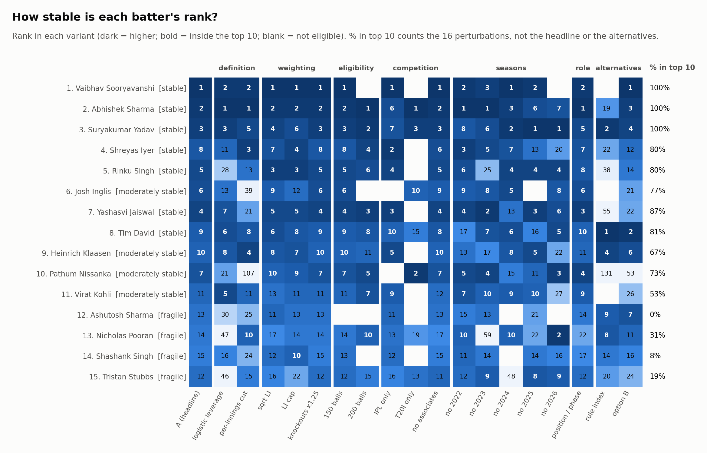
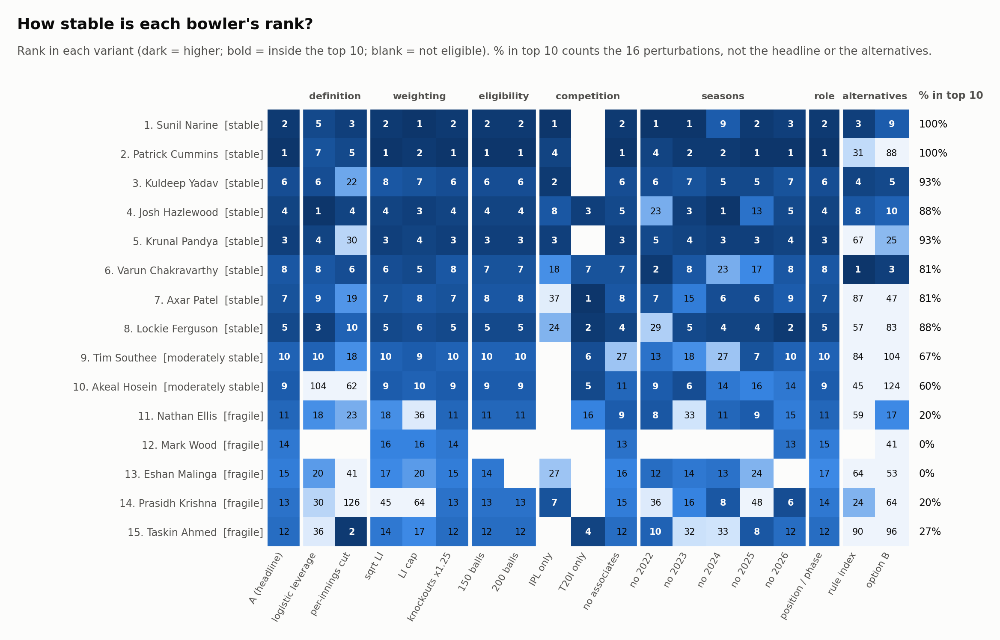

# Phase 6 — Robustness, option B, tie-break and the recommended final ordering

**Status (updated after your review).** The pairwise tie-break is approved and a stability guard has been added. **§12 is the current final ordering**; §5–§6 show the unguarded version you reviewed.

Every number below comes from `python -m src.pipeline` (tables in `outputs/tables/phase6/` and `outputs/tables/phase5/`, heatmaps in `outputs/figures/phase6/`). All 57 tests pass. This run reused the cached Phase 2–3 models; the fresh `--force` run is still due before Phase 7.

## 1. Summary

- **Intervals now come from posterior simulation** (§2). The bootstrap correction was a moment fix, not a standard method, so it is gone.
- **One correction to the reliability figures:** the 0.33 and 0.19 reported in Phase 5 were already Spearman–Brown corrected. The raw split-half correlations are 0.20 and 0.11 (§3).
- **Option B overlaps option A on 5 of 10 batters and 4 of 10 bowlers** (§4).
- **The tie-break rule had to be read pairwise.** Every adjacent pair in ranks 1–15 is indistinguishable, so a chained reading would have replaced A with B for the whole region (§5).
- **Recommended final top 10** (§6): 6 batters and 6 bowlers are stable or moderately stable across 18 sensitivity variants; places 9–15 are genuinely interchangeable.

## 2. Fix: from bootstrap correction to posterior simulation

**What the old correction did.** In a bootstrap resample each player's raw value carries sampling noise twice: once from the data, once from the resampling. So across players, variance ≈ real spread + s² + s². The correction estimated the real spread inside each resample as observed variance − 2 × mean(s²). That is a method-of-moments argument, but it assumes the resampling noise equals the original noise for every player. That is only roughly true for players with 20–30 matches, and it is not a standard method.

**What replaced it (your option).** Each player's true value is drawn from their empirical-Bayes posterior:

- **pressure value, usual level and uplift:** normal, mean = shrunk value, variance = τ²s² ÷ (τ² + s²);
- **consistency:** beta posterior from the beta-binomial prior.

Each of 4,000 draws is turned into both ratings and ranked; 90% intervals and P(top 10) are read from the draws. Limitation: τ² and the beta prior are held at their estimates, so the uncertainty in those hyperparameters is not included.

**Effect.** P(top 10) values are somewhat lower and more even than with the bootstrap (Cummins 0.81 → 0.68, Narine 0.70 → 0.58). The order of option A is unchanged.

## 3. Fix: reliabilities, raw and corrected

The Phase 5 reliabilities were already Spearman–Brown corrected (2r ÷ (1 + r)). Applying the correction again would overstate them, so the "≈ 0.50 batters, ≈ 0.32 bowlers" in your note would be a double correction. Both versions, uniform weighting, mean over 200 random half-splits:

| Component | Batters: raw r | Batters: corrected | Bowlers: raw r | Bowlers: corrected |
|---|---|---|---|---|
| Pressure value | 0.20 | **0.33** | 0.11 | **0.19** |
| Uplift | 0.01 | −0.00 | −0.03 | −0.07 |
| Consistency | 0.04 | 0.08 | 0.08 | 0.15 |
| Usual value (reference) | 0.25 | 0.39 | 0.15 | 0.25 |

The corrected value is the reliability of the full-sample measure; it is what the weights use. (The corrected uplift is slightly below zero because it is the mean of each split's corrected value, not the correction of the mean.)

## 4. Option B: hierarchical

> **B = player's own usual level (ordinary balls, re-weighted to the phases of their pressure balls), shrunk towards the population mean + their uplift, shrunk towards zero by its estimated spread.**

Uplift's estimated spread is close to zero for both roles, so B is essentially "how good this player is in the phases where their pressure balls fall". It is what the data say a player's pressure ability is once the non-reproducible part is discounted.

| | Batters | Bowlers |
|---|---|---|
| Top-10 overlap, A and B | **5 of 10** | **4 of 10** |
| Rank correlation, A and B (all eligible) | 0.69 | 0.36 |
| In A's top 10 only | Josh Inglis, Pathum Nissanka, Rinku Singh, Shreyas Iyer, Yashasvi Jaiswal | Akeal Hosein, Axar Patel, Krunal Pandya, Lockie Ferguson, Patrick Cummins, Tim Southee |
| In B's top 10 only | Andre Russell, Ashutosh Sharma, Dinesh Karthik, Muhammad Waseem, Phil Salt | Bhuvneshwar Kumar, Blessing Muzarabani, Jasprit Bumrah, Mohsin Khan, Noor Ahmad, Prince Yadav |

The disagreement is the uplift question in another form: players who did better (or worse) on pressure balls than their usual level. A credits that record; B discounts it because it does not reproduce.

## 5. The tie-break rule

**Your rule.** A is the headline; where adjacent players in ranks 1–15 are statistically indistinguishable (overlapping 90% intervals and P(top 10) within 0.15), order them by B.

**What the data gave.** Every one of the 14 adjacent pairs is indistinguishable, in both roles. All composite intervals overlap, and no two neighbours differ in P(top 10) by more than 0.12. Applied as a chain, that makes ranks 1–15 one block, and B decides the whole order: Cummins, A's #1 with P(top 10) 0.68, would drop to 12th behind players he is clearly separable from (P(top 10) 0.17–0.23).

**How I applied it: pairwise.**

- Two players **keep A's order whenever they are distinguishable from each other directly** (P(top 10) more than 0.15 apart, or no interval overlap).
- **Among the orders that respect all those pairs, the one that follows B most closely is chosen.** At each position, take the highest-B player not outranked by a remaining distinguishable player.
- This uses your test and your tie-breaker, but stops a run of small steps from reordering players who are clearly apart. **It needs your confirmation.**

**What changed** (A rank → final rank):

| Batters | A → final | Why | | Bowlers | A → final | Why |
|---|---|---|---|---|---|---|
| Shreyas Iyer | 8 → 4 | B 12th; tied with Jaiswal, Rinku, Inglis | | Sunil Narine | 2 → 1 | Tied with Cummins (P 0.58 v 0.68); B prefers Narine (9th v 88th) |
| Yashasvi Jaiswal | 4 → 7 | B 22nd | | Patrick Cummins | 1 → 2 | B 88th: his pressure record far exceeds his usual level |
| Tim David | 9 → 8 | B 2nd | | Kuldeep Yadav | 6 → 3 | B 5th |
| Heinrich Klaasen | 10 → 9 | B 6th | | Krunal Pandya | 3 → 5 | B 25th |
| Ashutosh Sharma | 13 → **10** | B 7th; enters the top 10 | | Varun Chakravarthy | 8 → 6 | B 3rd |
| Shashank Singh | 15 → 11 | B 16th | | Lockie Ferguson | 5 → 8 | B 83rd |
| Pathum Nissanka | 7 → **13** | B 53rd; leaves the top 10 | | Nathan Ellis | 11 → **9** | B 17th; enters |
| Virat Kohli | 11 → 15 | B 26th | | Mark Wood | 14 → **10** | B 41st; enters |
| | | | | Tim Southee | 10 → **14** | B 104th; leaves |
| | | | | Akeal Hosein | 9 → **15** | B 124th; leaves |

Final v A top 10: **9 of 10 batters and 8 of 10 bowlers are the same.**

## 6. Recommended final ordering (A with the pairwise tie-break)

Stability = share of the 17–18 sensitivity variants (where the player is eligible) in which they are in the top 10. Stable ≥ 80%, moderately stable 50–79%, fragile below 50%.

### Batters

| # | Player | A | B | P(top 10) | In top 10 across variants | Worst rank | Stability |
|---|---|---|---|---|---|---|---|
| 1 | Vaibhav Sooryavanshi | 1 | 1 | 0.64 | 100% (14 variants) | 3 | stable |
| 2 | Abhishek Sharma | 2 | 3 | 0.66 | 94% | 19 | stable |
| 3 | Suryakumar Yadav | 3 | 4 | 0.54 | 100% | 8 | stable |
| 4 | Shreyas Iyer | 8 | 12 | 0.33 | 71% | 22 | moderately stable |
| 5 | Rinku Singh | 5 | 14 | 0.41 | 71% | 38 | moderately stable |
| 6 | Josh Inglis | 6 | 21 | 0.38 | 71% | 39 | moderately stable |
| 7 | Yashasvi Jaiswal | 4 | 22 | 0.48 | 76% | 55 | moderately stable |
| 8 | Tim David | 9 | 2 | 0.30 | 83% | 17 | stable |
| 9 | Heinrich Klaasen | 10 | 6 | 0.27 | 71% | 22 | moderately stable |
| 10 | Ashutosh Sharma | 13 | 7 | 0.22 | 15% | 30 | **fragile** |
| 11 | Shashank Singh | 15 | 16 | 0.22 | 7% | 24 | fragile |
| 12 | Tristan Stubbs | 12 | 24 | 0.23 | 17% | 48 | fragile |
| 13 | Pathum Nissanka | 7 | 53 | 0.35 | 65% | 131 | moderately stable |
| 14 | Nicholas Pooran | 14 | 11 | 0.15 | 33% | 59 | fragile |
| 15 | Virat Kohli | 11 | 26 | 0.20 | 50% | 27 | moderately stable |

### Bowlers

| # | Player | A | B | P(top 10) | In top 10 across variants | Worst rank | Stability |
|---|---|---|---|---|---|---|---|
| 1 | Sunil Narine | 2 | 9 | 0.58 | 100% | 9 | stable |
| 2 | Patrick Cummins | 1 | 88 | 0.68 | 88% | 88 | stable |
| 3 | Kuldeep Yadav | 6 | 5 | 0.34 | 94% | 22 | stable |
| 4 | Josh Hazlewood | 4 | 10 | 0.42 | 89% | 23 | stable |
| 5 | Krunal Pandya | 3 | 25 | 0.48 | 82% | 67 | stable |
| 6 | Varun Chakravarthy | 8 | 3 | 0.27 | 83% | 23 | stable |
| 7 | Axar Patel | 7 | 47 | 0.27 | 72% | 87 | moderately stable |
| 8 | Lockie Ferguson | 5 | 83 | 0.39 | 78% | 83 | moderately stable |
| 9 | Nathan Ellis | 11 | 17 | 0.22 | 18% | 59 | **fragile** |
| 10 | Mark Wood | 14 | 41 | 0.19 | 0% (7 variants) | 41 | **fragile** |
| 11 | Eshan Malinga | 15 | 53 | 0.18 | 0% | 64 | fragile |
| 12 | Prasidh Krishna | 13 | 64 | 0.17 | 18% | 126 | fragile |
| 13 | Taskin Ahmed | 12 | 96 | 0.19 | 24% | 96 | fragile |
| 14 | Tim Southee | 10 | 104 | 0.23 | 59% | 104 | moderately stable |
| 15 | Akeal Hosein | 9 | 124 | 0.22 | 53% | 124 | moderately stable |

**A tension to decide (§11).** The tie-break promotes three fragile players into the top 10: Ashutosh Sharma (batting), Nathan Ellis and Mark Wood (bowling). Two moderately stable players drop out: Nissanka (batting, 65% of variants in the top 10), and Southee and Hosein (bowling, 59% and 53%). Mark Wood is eligible in only 7 of 18 variants (108 pressure balls), and in none of them is he in the top 10.

## 7. What the sensitivity analysis shows

How many of the headline top 10 stay in the top 10 under each variant:

| Variant | Batters | Bowlers | | Variant | Batters | Bowlers |
|---|---|---|---|---|---|---|
| √LI weight | 10 | 10 | | IPL only | 8 | 5 |
| LI cap weight | 9 | 10 | | T20I only | 4 | 6 |
| Knockouts ×1.25 | 10 | 10 | | Without 2022 | 8 | 7 |
| Eligibility 150 | 10 | 10 | | Without 2023 | 8 | 8 |
| Eligibility 200 | 7 | 10 | | Without 2024 | 8 | 7 |
| Associates excluded | 10 | 8 | | Without 2025 | 6 | 7 |
| Position / phase relative | 9 | 10 | | Without 2026 | 7 | 9 |
| Logistic leverage | 6 | 9 | | Per-innings cut | 6 | 5 |
| Rule index | **3** | **4** | | Option B | 5 | 4 |

- **The rating choices barely matter:** weighting, knockout weight, eligibility, associates and role baselines leave 9–10 of the top 10 in place (except eligibility 200 for batters, which removes three players below the bar).
- **The data matter:** dropping a single season changes 2–4 names, and single-competition rankings change more. This is the low reliability showing through.
- **The pressure definition matters most:** the per-innings cut changes 4–5 names and the rule index 6–7, as expected for a genuinely different definition (Phase 2b §8).

## 8. Notable absences

Evidence from each player's pressure-ball record only.

### Batters

| Player | Overall rank | Final rank | Pressure balls | Pressure value raw → shrunk (90%) | P(top 10) | Why, from the record |
|---|---|---|---|---|---|---|
| Virat Kohli | 45 | 15 | 603 | +27.3 → +19.6 (4.4 to 34.9) | 0.20 | Scored at expectation (−1 run per 100 balls); dismissed 14 times against 28.3 expected. Valuable, mainly by not getting out; others scored much faster. |
| Rashid Khan | 10 | 19 | 145 | +34.8 → +14.0 (−7.9 to 35.5) | 0.19 | +21 runs per 100 balls above expectation, dismissed 11 times against 13.2 expected: a good record on only 145 balls, so heavily shrunk. |
| Andre Russell | 3 | 78 | 143 | +4.5 → +3.9 (−17.3 to 25.2) | 0.02 | +9 runs per 100 balls above expectation, but dismissed 14 times against 9.3 expected on 143 balls. On ordinary balls he is +53.6. |
| Rajat Patidar | 9 | 104 | 121 | −11.1 → −0.7 (−23.2 to 21.3) | 0.01 | +12 runs per 100 balls, but dismissed 9 times against 5.3 expected on 121 balls. |
| Jasprit Bumrah | – | – | – | – | – | Not eligible as a batter. |

### Bowlers

| Player | Overall rank | Final rank | Pressure balls | Pressure value raw → shrunk (90%) | P(top 10) | Why, from the record |
|---|---|---|---|---|---|---|
| Jasprit Bumrah | 3 | 16 | 462 | +19.1 → +6.4 (−6.9 to 19.7) | 0.14 | Conceded 22 runs per 100 balls fewer than expected (excellent), but took 19 wickets against 24.8 expected. On ordinary balls he is +30.1. Just outside the top 15. |
| Rashid Khan | 20 | 17 | 622 | +13.2 → +5.1 (−7.3 to 16.8) | 0.12 | Conceded 21 runs per 100 fewer than expected and boundaries on 12% of balls (average 19%); 35 wickets against 32.6. Consistently good, not exceptional; also adjusted down 4.6 for the opposition he faced. |
| Corbin Bosch | 2 | 38 | 121 | +27.2 → +2.2 (−13.7 to 17.9) | 0.09 | Good record (10 runs per 100 fewer than expected, 10 wickets against 7.3) on only 121 balls: heavily shrunk. |
| Andre Russell | 89 | 87 | 279 | −16.8 → −6.6 (−21.1 to 7.5) | 0.02 | Conceded 34 runs per 100 more than expected; boundaries on 27% of balls. |
| Virat Kohli, Rajat Patidar | – | – | – | – | – | Not eligible as bowlers. |

## 9. Sooryavanshi evidence card

| | |
|---|---|
| Final rank | **1** (A: 1, B: 1) |
| Matches / with pressure balls | 31 / 23 |
| Pressure balls faced | **177** (eligibility bar: 100) |
| What happened on them | 416 runs against 282 expected (+76 runs per 100 balls); dismissed 8 times against 7.6 expected; boundaries on 42% of balls |
| Pressure value | raw +84.8 → shrunk **+34.3** (90% interval +13.5 to +55.0) |
| P(top 10) | **0.64** under A; 0.94 under B; 0.93 when every player is cut to 100 pressure balls |
| Rank interval (90%) | 1 to 47 |
| Stability | In the top 10 in **all 14 variants** where he is eligible (worst rank 3); not eligible in T20I-only, eligibility 200, rule index or without 2026 |
| Usual value (ordinary balls) | +56.4: the best in the data, so A and B agree |
| Competition mix | 78% of his balls in IPL; opposition adjustment +6.0 per 100 balls |

**Reading it.** The short career is visible in the interval (1 to 47) and the heavy shrinkage (from 84.8 to 34.3). He still ranks first because his record is extreme on both pressure and ordinary balls, which is why B also puts him first. The caveat for the report: 177 pressure balls in 23 matches is about a third of the evidence behind #2 and #3 (562 and 602), so his place is less certain than theirs even though his estimate is higher.

## 10. Limitations

- Pressure value is only moderately reliable (corrected 0.33 and 0.19); places 4–15 are close.
- The tie-break is applied pairwise (§5).
- Posterior simulation holds hyperparameters fixed, so intervals are slightly too narrow.
- Single-competition and leave-one-season-out variants shrink the eligible pool (67–125 players), which changes ranks for reasons beyond the variant itself.
- Not run: opposition tier offsets instead of the ridge model, and a recency weighting.
- This run reused cached Phase 2–3 models.

## 11. Decisions needed

| # | Question | My recommendation |
|---|---|---|
| 1 | Posterior simulation replaces the bootstrap | Confirm (your option) |
| 2 | Pairwise reading of the tie-break | Approve; the chained reading replaces A with B entirely |
| 3 | Fragile players promoted by the tie-break (Ashutosh Sharma, Ellis, Wood) over moderately stable ones (Nissanka, Southee, Hosein) | **Your call.** Either keep the rule's output as it is, or add a stability guard: the tie-break may not promote a fragile player above a moderately stable or stable one. I will compute the guarded order if you choose it |
| 4 | Ready for Phase 7 after the fresh `--force` run | Yes |

## 12. Update: stability over 16 perturbations, and the guarded final order

### 12.1 What changed

- **Stability now counts the 16 perturbation variants only:** logistic leverage, per-innings cut, √LI, LI cap, knockouts ×1.25, eligibility 150 and 200, IPL only, T20I only, associates excluded, the five leave-one-season-out runs, and the role-relative baseline. The rule index and option B are shown as "alternative definitions" and not counted.
- **Stability guard:** the tie-break never moves a fragile player above a stable or moderately stable one, and only stable or moderately stable players may be in the final top 10.

**Class changes from dropping the rule index:** five players move up, and nobody moves into or out of "fragile".

| Player | Before (17–18 variants) | After (16) |
|---|---|---|
| Shreyas Iyer | moderately stable (71%) | **stable** (80%) |
| Rinku Singh | moderately stable (71%) | **stable** (80%) |
| Yashasvi Jaiswal | moderately stable (76%) | **stable** (87%) |
| Axar Patel | moderately stable (72%) | **stable** (81%) |
| Lockie Ferguson | moderately stable (78%) | **stable** (88%) |

### 12.2 Final order: batters

"% top 10" = share of the 16 perturbations (where eligible) with the player in the top 10. Interval = 90% posterior interval of shrunk pressure value, runs per 100 balls.

| Final | Player | A | B | Class | % top 10 | P(top 10) | Shrunk value (90% interval) |
|---|---|---|---|---|---|---|---|
| 1 | Vaibhav Sooryavanshi | 1 | 1 | stable | 100% | 0.64 | 34.3 (13.5 to 55.0) |
| 2 | Abhishek Sharma | 2 | 3 | stable | 100% | 0.66 | 30.5 (15.3 to 45.5) |
| 3 | Suryakumar Yadav | 3 | 4 | stable | 100% | 0.54 | 28.3 (13.1 to 43.3) |
| 4 | Shreyas Iyer | 8 | 12 | stable | 80% | 0.33 | 23.5 (6.7 to 40.5) |
| 5 | Rinku Singh | 5 | 14 | stable | 80% | 0.41 | 24.0 (5.2 to 42.8) |
| 6 | Josh Inglis | 6 | 21 | moderately stable | 77% | 0.38 | 24.7 (3.9 to 45.3) |
| 7 | Yashasvi Jaiswal | 4 | 22 | stable | 87% | 0.48 | 25.0 (9.5 to 40.8) |
| 8 | Tim David | 9 | 2 | stable | 81% | 0.30 | 20.9 (2.4 to 38.9) |
| 9 | Heinrich Klaasen | 10 | 6 | moderately stable | 67% | 0.27 | 20.4 (1.2 to 40.0) |
| 10 | Pathum Nissanka | 7 | 53 | moderately stable | 73% | 0.35 | 20.9 (5.9 to 35.6) |
| 11 | Virat Kohli | 11 | 26 | moderately stable | 53% | 0.20 | 19.6 (4.4 to 34.9) |
| 12 | Ashutosh Sharma | 13 | 7 | fragile | 0% | 0.22 | 19.6 (−2.2 to 40.8) |
| 13 | Nicholas Pooran | 14 | 11 | fragile | 31% | 0.15 | 18.3 (2.2 to 34.2) |
| 14 | Shashank Singh | 15 | 16 | fragile | 8% | 0.22 | 16.6 (−4.7 to 38.2) |
| 15 | Tristan Stubbs | 12 | 24 | fragile | 19% | 0.23 | 15.4 (−2.9 to 33.1) |

### 12.3 Final order: bowlers

| Final | Player | A | B | Class | % top 10 | P(top 10) | Shrunk value (90% interval) |
|---|---|---|---|---|---|---|---|
| 1 | Sunil Narine | 2 | 9 | stable | 100% | 0.58 | 11.3 (−1.8 to 24.7) |
| 2 | Patrick Cummins | 1 | 88 | stable | 100% | 0.68 | 11.4 (−2.3 to 25.5) |
| 3 | Kuldeep Yadav | 6 | 5 | stable | 93% | 0.34 | 7.7 (−5.8 to 20.9) |
| 4 | Josh Hazlewood | 4 | 10 | stable | 88% | 0.42 | 13.7 (0.7 to 26.8) |
| 5 | Krunal Pandya | 3 | 25 | stable | 93% | 0.48 | 10.9 (−2.9 to 24.9) |
| 6 | Varun Chakravarthy | 8 | 3 | stable | 81% | 0.27 | 8.6 (−4.2 to 21.4) |
| 7 | Axar Patel | 7 | 47 | stable | 81% | 0.27 | 9.3 (−3.3 to 22.5) |
| 8 | Lockie Ferguson | 5 | 83 | stable | 88% | 0.39 | 11.8 (−2.4 to 26.2) |
| 9 | Tim Southee | 10 | 104 | moderately stable | 67% | 0.23 | 5.6 (−9.3 to 20.3) |
| 10 | Akeal Hosein | 9 | 124 | moderately stable | 60% | 0.22 | 6.7 (−5.6 to 19.4) |
| 11 | Nathan Ellis | 11 | 17 | fragile | 20% | 0.22 | 6.2 (−8.4 to 20.2) |
| 12 | Mark Wood | 14 | 41 | fragile | 0% (6 variants) | 0.19 | 6.0 (−9.5 to 21.8) |
| 13 | Eshan Malinga | 15 | 53 | fragile | 0% | 0.18 | 3.2 (−11.7 to 18.3) |
| 14 | Prasidh Krishna | 13 | 64 | fragile | 20% | 0.17 | 5.0 (−8.6 to 18.6) |
| 15 | Taskin Ahmed | 12 | 96 | fragile | 27% | 0.19 | 3.9 (−11.0 to 18.7) |

**The guarded final top 10s contain exactly the same players as A's top 10s**, in both roles. The guard removed every fragile promotion (Ashutosh Sharma; Ellis and Wood), and the tie-break only reorders inside the top 10.

### 12.4 Every position that differs from A, and why

| Role | Player | A → final | Reason |
|---|---|---|---|
| Batter | Shreyas Iyer | 8 → 4 | Tie-break: indistinguishable from Jaiswal, Rinku and Inglis, and ahead of all three on B (12 v 22, 14, 21) |
| Batter | Yashasvi Jaiswal | 4 → 7 | Tie-break: B rank 22, below Iyer, Rinku and Inglis |
| Batter | Tim David | 9 → 8 | Tie-break: B rank 2 |
| Batter | Heinrich Klaasen | 10 → 9 | Tie-break: B rank 6 |
| Batter | Pathum Nissanka | 7 → 10 | Tie-break: B rank 53. The guard keeps him in the top 10 (moderately stable), while Ashutosh Sharma (fragile) may not pass him |
| Batter | Ashutosh Sharma | 13 → 12 | Tie-break: B rank 7 lifts him past Pooran and Stubbs; the guard stops him at 12 |
| Batter | Nicholas Pooran | 14 → 13 | Tie-break: B rank 11 |
| Batter | Shashank Singh | 15 → 14 | Tie-break: B rank 16 |
| Batter | Tristan Stubbs | 12 → 15 | Tie-break: B rank 24, last of the fragile group |
| Bowler | Sunil Narine | 2 → 1 | Tie-break with Cummins (P(top 10) 0.58 v 0.68, within 0.15): B rank 9 v 88 |
| Bowler | Patrick Cummins | 1 → 2 | The other side of the same pair |
| Bowler | Kuldeep Yadav | 6 → 3 | Tie-break: B rank 5 |
| Bowler | Krunal Pandya | 3 → 5 | Tie-break: B rank 25 |
| Bowler | Varun Chakravarthy | 8 → 6 | Tie-break: B rank 3 |
| Bowler | Lockie Ferguson | 5 → 8 | Tie-break: B rank 83 |
| Bowler | Tim Southee | 10 → 9 | Tie-break with Hosein: B rank 104 v 124 |
| Bowler | Akeal Hosein | 9 → 10 | The other side of the same pair |
| Bowler | Mark Wood | 14 → 12 | Tie-break: B rank 41; the guard keeps him out of the top 10 |
| Bowler | Eshan Malinga | 15 → 13 | Tie-break: B rank 53 |
| Bowler | Prasidh Krishna | 13 → 14 | Tie-break: B rank 64 |
| Bowler | Taskin Ahmed | 12 → 15 | Tie-break: B rank 96 |

Unchanged: Sooryavanshi, Abhishek Sharma, Suryakumar, Rinku Singh, Inglis, Kohli; Hazlewood, Axar Patel, Nathan Ellis.

### 12.5 Framing carried into Phase 7

- **High in A, low in B** (Cummins 88th in B, Ferguson 83rd, Southee 104th, Hosein 124th, Nissanka 53rd): *"delivered under pressure in this window; we do not claim it predicts future pressure performance."* This is the same conclusion as the uplift finding: their pressure record is well above their usual level, and that kind of gap does not reproduce between halves of a player's matches.
- **Insight: Sunil Narine** is near the bottom of the batting table overall (116th of 121 on raw run value; 107th after the opposition adjustment) and the **#1 pressure bowler**. The two are measured on different balls with the same yardstick, which is why a player can sit at both ends.

