# Who performs when it matters? Ranking T20 batters and bowlers under pressure

**SupeRR Selector Season 2, Round 1: methodology report.** IPL and T20I ball-by-ball data, 2022–2026.

**Vaibhav Tiwari**, Vellore Institute of Technology · Code and outputs: [REPO_LINK]

Every number in this report is produced by one command (`python -m src.pipeline --force`) and is cross-checked against the generated tables by `python -m src.report.check_report` (Appendix E). Figures are in `outputs/report/figures/`; the submission files are `outputs/final_rankings.csv` (top 10 per role), `final_rankings_top15.csv` and `final_rankings_eligible.csv`.

---

## 0. Executive summary

**Pressure, in one sentence:** a ball is high pressure when the match result is expected to swing a lot on it: the expected change in the batting side's chance of winning, relative to an average ball.

**Method**

1. **Win probability** for every ball, from a model of how T20 innings unfold, chosen against three alternatives on seasons it had never seen.
2. **Pressure = leverage:** the top 25% of balls by expected win-probability swing are "high pressure" (Leverage Index above 1.15).
3. **Performance = runs above expectation** in exactly the same situation, with each wicket priced in runs for that situation.
4. **Fair comparison:** every ball is adjusted for the opponent's strength, which puts IPL and T20I on one scale.
5. **Honest rating:** short records are pulled towards the average, consistency is added, and only players who stay in the top 10 under at least half of 16 alternative choices are placed there.

| # | Batters | Bowlers |
|---|---|---|
| 1 | Vaibhav Sooryavanshi | Sunil Narine |
| 2 | Abhishek Sharma | Patrick Cummins |
| 3 | Suryakumar Yadav | Kuldeep Yadav |
| 4 | Shreyas Iyer | Josh Hazlewood |
| 5 | Rinku Singh | Krunal Pandya |
| 6 | Josh Inglis | Varun Chakravarthy |
| 7 | Yashasvi Jaiswal | Axar Patel |
| 8 | Tim David | Lockie Ferguson |
| 9 | Heinrich Klaasen | Tim Southee |
| 10 | Pathum Nissanka | Akeal Hosein |

**Headline findings**

- **Pressure is mostly a chase phenomenon:** 89% of high-pressure balls are bowled in the second innings.
- **Rules of thumb pick the wrong balls:** a required-rate-and-wickets index shares only 24% of its high-pressure balls with leverage, about chance level.
- **Who delivered under pressure is measurable; who "raises their game" is not.** Pressure performance reproduces between halves of a player's matches (reliability 0.33 batters, 0.19 bowlers); the gap between pressure and usual level does not (0.00 and −0.07).

---

## 1. Defining pressure

### 1.1 The definition

- **Win probability (WP)** is the chance that the batting side wins from the current state: score, wickets down, balls left and, in a chase, the target.
- **Leverage** is how much WP is expected to move on the next ball: the average absolute change in WP over everything that could happen on it (dot, single, four, six, wicket, wide, and so on), weighted by how likely each outcome is.
- **Leverage Index (LI)** is leverage divided by its average over all balls. LI 1.0 is an average ball; LI 2.0 matters twice as much.
- **High-pressure ball:** a ball in the top 25% of all balls by LI. That means **LI above 1.15**. Of 193,501 scored balls, 48,376 are high pressure. The definition is the same for batter and bowler and describes the match situation, not who is in it.

### 1.2 Why leverage, not a rule of thumb

The common alternative is a rule built from required rate, wickets lost and overs left. We built one (weights in `config.yaml`) and compared it with leverage on every ball.

| Situation | Win probability | LI |
|---|---|---|
| Chase: need 60 off 12 balls, 8 down | 0.0% | 0.00 |
| Chase: need 9 off 6 balls, 5 down | 81.5% | 5.48 |
| Chase: need 20 off 30 balls, 9 down | 46.8% | 3.43 |
| First innings: 25 for 4 after 5 overs | 11.7% | 0.39 |

- **"Need 60 off 12, 8 down"** scores near the top of any required-rate rule: 30 an over with two wickets left. Leverage is zero, because the match is already lost and no single ball can change that.
- **Collapses are low leverage after the fact.** At 25 for 4 the damage is done; the pressure was on the balls before the wickets fell.
- **The two measures barely agree.** Rank correlation over all balls is 0.05, and only **24%** of leverage's top quarter is also in the rule's top quarter, about the 25% that chance would give. Balls that only the rule flags are in lopsided games: on average their WP is 31 points from even, against 16 for balls that only leverage flags (Figure A1).

### 1.3 Choosing the win-probability model

Four candidates saw identical information and were judged only on seasons they had not seen: each model was trained on four seasons and tested on the fifth, rotating (185,070 held-out balls from 774 matches). Log-loss measures how good the probabilities are (lower is better; a coin flip scores 0.6931).

| Model | Log-loss, all balls | Log-loss, last 12 balls of a chase | Calibration error | Leverage roughness, chase |
|---|---|---|---|---|
| Logistic regression | **0.5137** | 0.2129 | **0.0087** | **0.0067** |
| XGBoost (monotone) | 0.5223 | 0.2179 | 0.0252 | 0.1880 |
| LightGBM (monotone) | 0.5297 | 0.2280 | 0.0325 | 0.2113 |
| Dynamic programming (DP) | 0.5176 | **0.1994** | 0.0269 | 0.0168 |
| **DP + recalibration (chosen)** | 0.5165 | 0.2024 | 0.0131 | 0.0164 |

"Leverage roughness" compares each state's leverage with its neighbours one run either side; tree models move in steps, so about a fifth of their leverage is noise.

**Why DP + recalibration.** It is statistically tied with logistic regression overall (logistic is better by 0.0027, 95% interval for the difference −0.0098 to +0.0045) and better at the end of chases, where pressure lives. It obeys the laws exactly: on the last ball with one run needed, the chasing side won all 6 times in the held-out data; the DP said 82%, logistic regression 67%. Every DP probability is an explicit sum over ball outcomes, so there is no black box. A two-parameter recalibration per innings, fitted on other seasons, halves its calibration error. Logistic-model leverage is a robustness check (§5).

### 1.4 Evidence that pressure balls are different

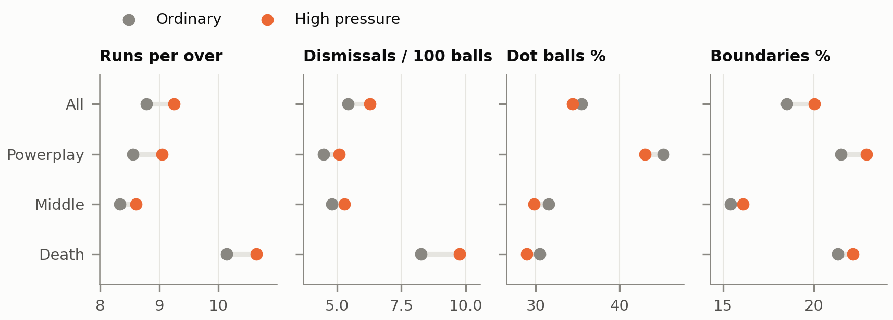

*Figure 1. High-pressure balls are higher-risk, higher-reward cricket in every phase: more runs, more wickets, more boundaries, fewer dots.*

Across all balls, high-pressure balls go for 9.25 runs per over against 8.78, with 6.29 dismissals per 100 balls against 5.43 and boundaries on 20.0% against 18.5%. Each phase is compared with itself, so the gap is not just "death overs". The stakes are real: a quarter of the balls (24.8%) carry **47.9%** of all the win-probability movement that actually happened, and the average realised swing is 2.49% per ball against 0.89%.

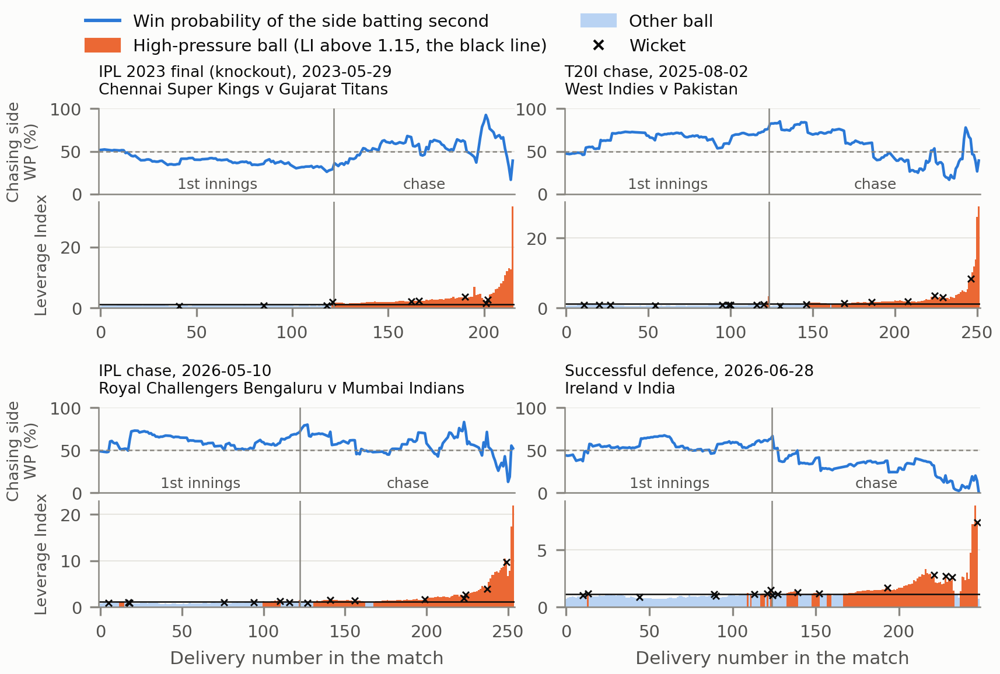

*Figure 2. In close finishes leverage sits near 1 through the first innings and climbs through the chase as the result stays in doubt, peaking in the final over.*

The four matches were chosen by rule (the tightest decided match in each category), not by reputation. In the **IPL 2023 final** (Chennai Super Kings v Gujarat Titans, won by Chennai off the last ball), the jump in WP at the innings break is the rain revision to a 15-over chase, which nobody knew during the first innings.

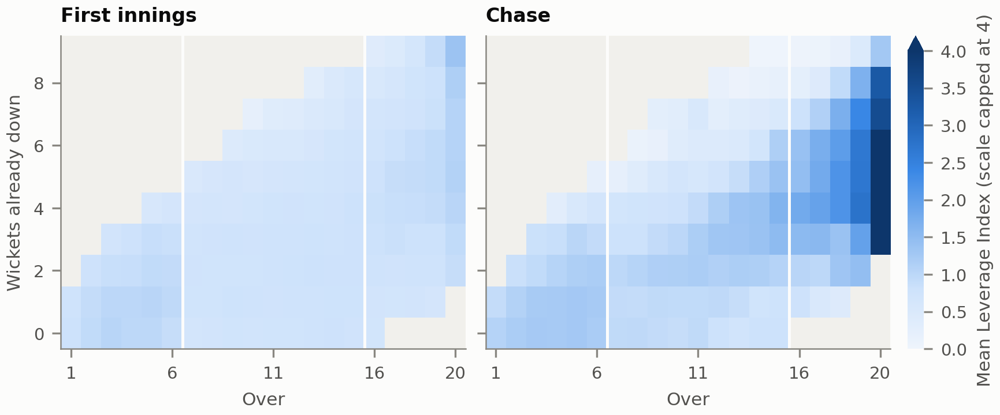

*Figure 3. Pressure is high when the contest is close and time is short: chase balls in the last overs with wickets in hand; first-innings leverage barely varies.*

### 1.5 Where pressure falls

- **89% of high-pressure balls are in the second innings.** 47.1% of chase balls qualify, against 5.2% of first-innings balls. In the first innings nobody knows what a good score is, so no single ball moves the result much; in a chase every ball is measured against a known target.
- **Pressure is not "death bowling".** The death overs supply only 24.5% of high-pressure balls; the middle overs supply 39.3%. Many chases are decided before the 16th over.
- **Every role gets pressure balls.** Batting positions 1 to 8 each have 24–26% of their balls flagged.

---

## 2. Measuring performance

### 2.1 Run value per ball

For every ball, one number per player, in runs:

- **Batting:** `value = (runs off the bat − expected runs) − c × (dismissed − expected chance of dismissal)`
- **Bowling:** `value = (expected runs conceded − runs conceded) + c × (wicket − expected chance of a wicket)`

Positive is good for the player. **Expected** means what a league-average player does in exactly the same situation. **c** is the price of a wicket in runs for that situation (§2.3). A batter who scores at the expected rate and gets out at the expected rate earns zero, whatever the situation; that is what lets a ball in the powerplay be compared with a ball in the 19th over.

Crediting rules: a run-out at the non-striker's end is charged to the dismissed batter; run-outs are not credited to bowlers; retired-out is charged to nobody.

### 2.2 The expectation models

Five models give the expectations: runs off the bat, striker dismissed, non-striker run out, runs charged to the bowler, bowler-credited wicket. They use the same features for batting and bowling: balls left, wickets in hand, powerplay, balls the striker has already faced, free hit, the season's scoring rate, IPL or T20I, associate match, and the chase state (runs required, required rate against the season's scoring rate).

- **Every ball's expectation comes from models that never saw its season** (cross-fitting by season), so no player is judged against a model that has learned their own matches.
- **They beat the traditional season × phase averages on held-out seasons**, for example a squared error of 2.949 against 3.034 for runs off the bat.
- **No feature can identify a match.** The season's scoring rate takes one value per season and competition. Appendix A shows what goes wrong otherwise.
- **The raw pressure gap disappears.** Raw strike rate is 138.3 on ordinary balls and 145.1 on high-pressure balls; run value is +0.5 and +1.1 runs per 100 balls, a gap within noise. Nobody is credited or blamed just for being in a high-pressure situation.

### 2.3 The wicket exchange rate

`c = WP lost if a wicket falls ÷ WP that one extra run is worth`, both read from the win-probability model one ball on. It converts a wicket into the number of runs that would have the same effect on the result (the full surface is Figure A2).

| State (IPL 2024 conditions) | Win probability | Wicket cost (runs) |
|---|---|---|
| Chase, early: need 180 off 114, 10 in hand | 69% | 15.2 |
| Chase, middle: need 90 off 60, 7 in hand | 70% | 7.3 |
| Chase, last 2 overs: need 20 off 12, 6 in hand | 81% | 1.9 |
| Chase, last 2 overs: need 20 off 12, last pair | 19% | 6.3 |
| Chase, last ball: need 3 off 1 | 45% | 0.0 |
| First innings: 50 for 5 after 8 overs | 11% | 14.1 |
| First innings: 150 for 8 after 17 overs | 28% | 8.2 |

- **Settled matches.** Where one run is worth almost no WP (the result is decided), the ratio is meaningless; the typical first-innings cost for the same overs left and wickets in hand is used instead (5.6% of balls).
- **Calibrated to what actually happens.** For every first-innings wicket we measured the runs the side actually went on to lose, against non-wicket balls in the same state. On average the model was right, but it was 3.2 runs too high with 16–20 overs left and 0.5 runs too low with 1–2 left. One monotone correction factor per overs-left band, fitted on other seasons, fixes this: across 5,165 wickets, 7.14 runs actually lost against 7.11 from the calibrated model (Figure A3). The first-innings factors are also applied in chases (a stated assumption, §5.4).
- **Capped** at 17.9 runs (the 99th percentile); the average cost is 8.5 runs.

### 2.4 Two baselines

- **League baseline (used in the ranking):** the expectation above, same situation, league-average player.
- **The player's own baseline (for the "clutch" question):** the player's value on ordinary balls, re-weighted to the phases of their pressure balls. **Uplift** = pressure value minus this baseline: how much better or worse than their usual self a player was under pressure (§5.3).

### 2.5 Leverage enters exactly once

Leverage decides **which** balls count (the top-25% cut). It does not also multiply the value of each ball: we compared equal weights, a cap on LI and √LI inside the pressure balls, and all three were equally reproducible (reliability 0.262, 0.231 and 0.253, within one standard deviation), so the simplest, equal weights, is used. Win probability added, which already contains leverage, is reported as a companion and never weighted again.

---

## 3. Fair comparisons

### 3.1 Eligibility

A player is ranked if they have **at least 100 high-pressure balls in at least 10 matches** in that role: **137 batters and 139 bowlers**. Everyone else is listed with the reason in `outputs/tables/phase4/eligibility.csv`; 150 and 200 balls are tested in §5.

### 3.2 Opposition and competition strength

A bowler who often bowls to weaker batting sides looks better than they are. On every ball, a **ridge regression** (a regression whose player effects are pulled towards their group's level unless the data insist otherwise) estimates how much easier that ball was because of who the opponent was: the opponent's tier (IPL, T20I top-8, other full member, associate), their group and their individual strength. Each ball's value is then adjusted for its opponent. The strength of the pull was chosen on held-out matches (penalty 1,000 balls), where the model predicts better than a league average (mean squared error 7.6299 against 7.6432).

**Acceptance test: the same players against different opposition.** If the adjustment works, a player's value should no longer depend on whom they faced.

| Same players (runs per 100 balls) | Before | After | Gap closed |
|---|---|---|---|
| 59 batters: v T20I top-8 minus v IPL | +9.5 | +1.5 | 85% |
| 43 batters: v other full members minus v top-8 | +1.2 | −3.3 | overshoots, within one standard error |
| 66 bowlers: v T20I top-8 minus v IPL | −2.9 | −0.5 | 84% |
| 45 bowlers: v other full members minus v top-8 | +17.0 | +0.7 | 96% |

**The test cases.** Three bowlers who rank very high on raw value but bowl mostly in bilateral T20Is against weaker batting fall once the opposition is accounted for. Ranked on all-ball value among the 125 bowlers with at least 500 balls, Blessing Muzarabani falls from 2nd to 8th, Mohammad Nawaz from 7th to 12th, and Mahedi Hasan from 14th to 39th (his value falls from +15.4 to +7.4 runs per 100 balls). Jasprit Bumrah, who bowls mostly in the IPL, stays 1st of the same 125.

### 3.3 One scale for IPL and T20I

The same model puts both competitions on one scale. **An average IPL performance is worth 10.7 runs per 100 balls more than an average T20I performance for batters, and 4.6 for bowlers.** A raw IPL number therefore understates an IPL player against a T20I-only player with the same number.

### 3.4 The era adjustment

IPL scoring rose sharply across the five seasons. Expectations are rescaled so that run value averages zero **within each competition and season**: a player is measured against the league they actually played in. Without it, batting value would be +5.1 runs per 100 balls in 2026 for nothing; with it, −0.2.

### 3.5 Exposure: who gets pressure balls

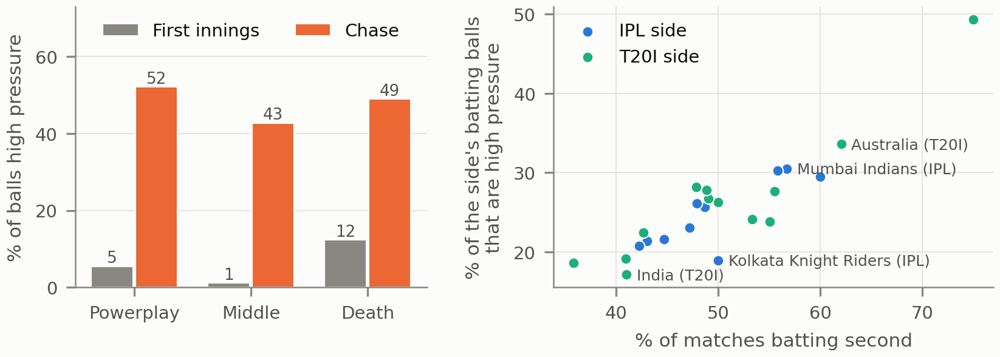

*Figure 4. Chase balls are where pressure lives, so a side's batters see more pressure the more often it bats second, and the less often it wins easily.*

- **For batters, exposure is mostly a toss-and-fixture effect.** How often a batter's side chased explains 57% of the differences in their share of pressure balls (24% for bowlers).
- **Team strength matters too.** Strong sides finish games early: India's batters faced the lowest share of pressure balls of any full member (17.1%), and in the IPL the share ranges from 18.9% (Kolkata Knight Riders) to 30.5% (Mumbai Indians).
- **Exposure changes the amount of evidence on a player, not their score**, because every ball is judged against its own situation. The rating handles the uneven evidence (§4.1), and the top 10 have the same share of balls in chases as the median eligible player (0.48 against 0.49 for batters).

---

## 4. Rating and results

### 4.1 From pressure-ball record to rating

1. **Pressure value** = a player's average run value per 100 high-pressure balls, after the opposition adjustment.
2. **Shrinkage (empirical Bayes).** A short record is mostly luck, so each player's pressure value is pulled towards the average of all players, more strongly the fewer balls they have. How strongly is learned from the data: from how much players' records spread out beyond what luck alone would produce.
3. **Consistency** = the share of a player's matches (with at least 6 pressure balls) in which they beat expectation, compared with the league rate (55.2% for batters, 44.5% for bowlers; they differ from 50% because a batter loses a lot on a dismissal and gains a little on most other balls), and shrunk in the same way.
4. **Composite.** Each component is standardised, then weighted by its **split-half reliability**: split each player's matches into two random halves, compute the measure on each half, and see how well the halves agree across players (repeated over 200 random splits). A component that does not reproduce gets no weight. No weights were chosen by hand.

| | Batters | Bowlers |
|---|---|---|
| Rating formula | 0.81 × z(pressure value) + 0.19 × z(consistency) | 0.57 × z(pressure value) + 0.43 × z(consistency) |
| In original units | 0.080 × pressure value + 0.124 × consistency points | 0.105 × pressure value + 0.183 × consistency points |
| Correlation of the two components | 0.72 | 0.79 |
| Uplift weight | 0 (reliability 0.00) | 0 (reliability −0.07) |

### 4.2 Reliability

Split-half reliability is reported in two forms. The **raw** figure is the correlation between halves; the **corrected** figure (Spearman–Brown, 2r ÷ (1 + r)) estimates the reliability of the full record, which is twice as long as a half. The corrected figure sets the weights.

| Component | Batters: raw | Batters: corrected | Bowlers: raw | Bowlers: corrected |
|---|---|---|---|---|
| Pressure value | 0.20 | **0.33** | 0.11 | **0.19** |
| Consistency | 0.04 | 0.08 | 0.08 | 0.15 |
| Uplift ("clutch") | 0.00 | 0.00 | −0.03 | −0.07 |
| Usual value (ordinary balls, reference) | 0.25 | 0.39 | 0.15 | 0.25 |

A corrected reliability of 0.33 means about a third of the spread in batters' pressure records is stable skill and two-thirds is luck; for bowlers it is about a fifth. That is why the shrinkage is strong, and why the uncertainty is shown with every rank.

**Uncertainty.** For each player, 4,000 values are drawn from the range of true values consistent with their record and the spread across players (their **posterior**); each draw is ranked. This gives a **90% interval** for the shrunk pressure value (the true value lies inside with 90% probability, under the model) and **P(top 10)**, the share of draws in which the player is in the top 10.

### 4.3 Ordering, tie-break and stability guard

- **Headline (option A):** rank by the composite rating.
- **Option B**, used only to break ties: each player's usual level (shrunk), plus their uplift shrunk towards zero by its tiny estimated spread. B asks "how good is this player in the phases where their pressure balls fall?"
- **Tie-break:** two players whose 90% intervals overlap **and** whose P(top 10) differ by at most 0.15 cannot be told apart; between such players B decides. Players who can be told apart directly always keep A's order.
- **Stability guard:** each player is re-ranked under 16 alternative choices (§5.1). A player is **stable** if in the top 10 in at least 80% of them, **moderately stable** from 50%, **fragile** below. The tie-break may never lift a fragile player above a stable or moderately stable one, and only stable or moderately stable players may enter the final top 10.

The guarded order contains exactly the same ten players per role as option A; the tie-break only reorders them.

**Labels.** Each player carries a descriptive label: **All-round** when option B agrees (B rank 30 or better): elite under pressure and overall. **Pressure-specific** when B ranks them below 30th: they delivered under pressure well beyond their usual level, which is exactly what the brief asks to find. One caveat applies to the label, stated once in §5.3.

### 4.4 The final top 10s

**The order follows Rating**, the composite of pressure value and consistency (§4.1), not shrunk value alone, so shrunk value need not fall steadily down the table; ‡ marks positions set by the tie-break (§4.3), explained under each table. Shrunk value = runs per 100 high-pressure balls above same-situation expectation, opposition-adjusted, after shrinkage. Consistency = points above the league rate of beating expectation, after shrinkage. Stability = class, with the share of the 16 variants in which the player is in the top 10. † = short record (fewer than 200 pressure balls), so the interval is wide.

**Batters**

| # | Player | ID | Team(s) | Pressure balls | Rating | Shrunk value | 90% interval | Consistency | P(top 10) | Stability | Label |
|---|---|---|---|---|---|---|---|---|---|---|---|
| 1 | Vaibhav Sooryavanshi † | 50284 | India, Rajasthan Royals | 177 | 2.51 | 34.3 | 13.5 to 55.0 | +1.5 | 0.64 | stable (100%) | All-round |
| 2 | Abhishek Sharma | 6281 | India, Sunrisers Hyderabad | 562 | 2.48 | 30.5 | 15.3 to 45.5 | +3.7 | 0.66 | stable (100%) | All-round |
| 3 | Suryakumar Yadav | 1699 | India, Mumbai Indians | 602 | 2.22 | 28.3 | 13.1 to 43.3 | +3.0 | 0.54 | stable (100%) | All-round |
| 4 | Shreyas Iyer ‡ | 3647 | India, Kolkata Knight Riders, Punjab Kings | 406 | 1.73 | 23.5 | 6.7 to 40.5 | +2.2 | 0.33 | stable (80%) | All-round |
| 5 | Rinku Singh | 4708 | India, Kolkata Knight Riders | 245 | 1.88 | 24.0 | 5.2 to 42.8 | +3.2 | 0.41 | stable (80%) | All-round |
| 6 | Josh Inglis † | 4736 | Australia, Lucknow Super Giants, Punjab Kings | 196 | 1.78 | 24.7 | 3.9 to 45.3 | +1.9 | 0.38 | moderately stable (77%) | All-round |
| 7 | Yashasvi Jaiswal ‡ | 6819 | India, Rajasthan Royals | 523 | 2.07 | 25.0 | 9.5 to 40.8 | +4.0 | 0.48 | stable (87%) | All-round |
| 8 | Tim David ‡ | 6396 | Australia, Mumbai Indians, Royal Challengers Bengaluru | 327 | 1.59 | 20.9 | 2.4 to 38.9 | +2.8 | 0.30 | stable (81%) | All-round |
| 9 | Heinrich Klaasen ‡ | 4260 | South Africa, Sunrisers Hyderabad | 263 | 1.48 | 20.4 | 1.2 to 40.0 | +2.2 | 0.27 | moderately stable (67%) | All-round |
| 10 | Pathum Nissanka ‡ | 6931 | Delhi Capitals, Sri Lanka | 626 | 1.77 | 20.9 | 5.9 to 35.6 | +4.2 | 0.35 | moderately stable (73%) | Pressure-specific |

‡ Set by the tie-break: Shreyas Iyer (A 8, B 12) cannot be told apart from Rinku Singh (A 5, B 14), Josh Inglis (A 6, B 21), Yashasvi Jaiswal (A 4, B 22) and Pathum Nissanka (A 7, B 53), so B orders them. Tim David (A 9, B 2) cannot be told apart from Pathum Nissanka (A 7, B 53), so B orders them. Heinrich Klaasen (A 10, B 6) cannot be told apart from Pathum Nissanka (A 7, B 53), so B orders them.

**Bowlers**

| # | Player | ID | Team(s) | Pressure balls | Rating | Shrunk value | 90% interval | Consistency | P(top 10) | Stability | Label |
|---|---|---|---|---|---|---|---|---|---|---|---|
| 1 | Sunil Narine ‡ | 781 | Kolkata Knight Riders | 394 | 2.62 | 11.3 | −1.8 to 24.7 | +7.1 | 0.58 | stable (100%) | All-round |
| 2 | Patrick Cummins ‡ | 1758 | Australia, Kolkata Knight Riders, Sunrisers Hyderabad | 304 | 2.95 | 11.4 | −2.3 to 25.5 | +8.8 | 0.68 | stable (100%) | Pressure-specific |
| 3 | Kuldeep Yadav ‡ | 3644 | Delhi Capitals, India | 409 | 1.89 | 7.7 | −5.8 to 20.9 | +5.2 | 0.34 | stable (93%) | All-round |
| 4 | Josh Hazlewood | 830 | Australia, Royal Challengers Bengaluru | 478 | 2.10 | 13.7 | 0.7 to 26.8 | +2.9 | 0.42 | stable (88%) | All-round |
| 5 | Krunal Pandya ‡ | 4219 | Lucknow Super Giants, Royal Challengers Bengaluru | 325 | 2.31 | 10.9 | −2.9 to 24.9 | +5.7 | 0.48 | stable (93%) | All-round |
| 6 | Varun Chakravarthy ‡ | 6256 | India, Kolkata Knight Riders | 470 | 1.65 | 8.6 | −4.2 to 21.4 | +3.4 | 0.27 | stable (81%) | All-round |
| 7 | Axar Patel | 2876 | Delhi Capitals, India | 568 | 1.66 | 9.3 | −3.3 to 22.5 | +3.0 | 0.27 | stable (81%) | Pressure-specific |
| 8 | Lockie Ferguson ‡ | 4692 | Gujarat Titans, Kolkata Knight Riders, New Zealand, Punjab Kings, Royal Challengers Bengaluru | 274 | 2.02 | 11.8 | −2.4 to 26.2 | +3.6 | 0.39 | stable (88%) | Pressure-specific |
| 9 | Tim Southee ‡ | 278 | Kolkata Knight Riders, New Zealand | 232 | 1.38 | 5.6 | −9.3 to 20.3 | +3.6 | 0.23 | moderately stable (67%) | Pressure-specific |
| 10 | Akeal Hosein ‡ | 2417 | Chennai Super Kings, Sunrisers Hyderabad, West Indies | 515 | 1.46 | 6.7 | −5.6 to 19.4 | +3.5 | 0.22 | moderately stable (60%) | Pressure-specific |

‡ Set by the tie-break: Sunil Narine (A 2, B 9) cannot be told apart from Patrick Cummins (A 1, B 88), so B orders them. Kuldeep Yadav (A 6, B 5) cannot be told apart from Josh Hazlewood (A 4, B 10), Krunal Pandya (A 3, B 25) and Lockie Ferguson (A 5, B 83), so B orders them. Varun Chakravarthy (A 8, B 3) cannot be told apart from Axar Patel (A 7, B 47) and Lockie Ferguson (A 5, B 83), so B orders them. Tim Southee (A 10, B 104) cannot be told apart from Akeal Hosein (A 9, B 124), so B orders them.

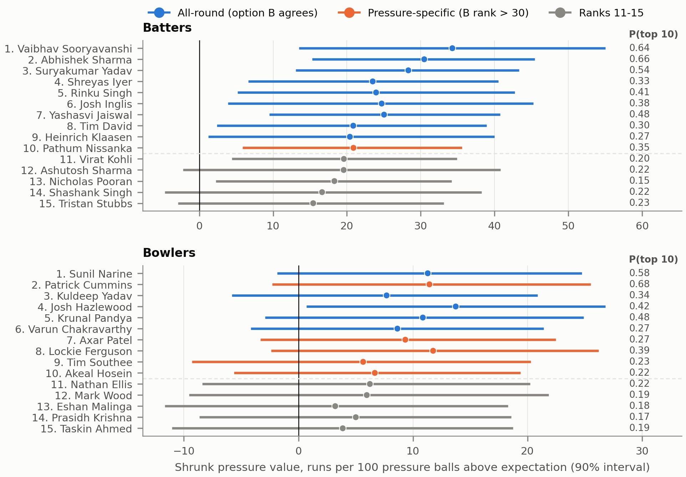

*Figure 5. Every interval overlaps its neighbours, so the order inside each top 10 is uncertain; bowlers' values are smaller and harder to separate from luck than batters'.*

**Evidence card: Vaibhav Sooryavanshi (batter #1, id 50284).**

| | |
|---|---|
| Rank | **1** under option A, option B and the final order |
| Record | 177 pressure balls in 23 matches (31 matches in all; eligibility bar 100 balls) |
| What happened | 416 runs against 282 expected (+76 runs per 100 balls); out 8 times against 7.6 expected; boundaries on 42% of balls |
| Breakdown of the raw value | runs above expectation +76.0, wicket term +1.9 (his 8 dismissals came where wickets were cheap, so they cost less than the 7.6 expected ones would have), non-striker run-out term +0.7, opposition adjustment +6.2: total +84.8 per 100 balls |
| Pressure value | raw +84.8, shrunk **+34.3** (90% interval +13.5 to +55.0) |
| P(top 10) | **0.64** (A); 0.94 (B); 0.93 if every player is cut to 100 pressure balls |
| 90% rank interval | 1 to 47 |
| Stability | in the top 10 in all 13 variants in which he is eligible (worst rank 3) |
| Usual level | +56.4 on ordinary balls, the best in the data, which is why option B also puts him first |

**Reading it.** The short career shows in the heavy shrinkage (84.8 to 34.3) and the wide rank interval. He is first because his record is extreme on both pressure and ordinary balls. His evidence is about a third of that behind #2 and #3 (562 and 602 pressure balls), so his place is less certain than theirs even though his estimate is higher.

### 4.5 Best overall v best under pressure

"Overall" rank = rank on opposition-adjusted run value over all balls, among the same eligible players as the pressure ranking (137 batters, 139 bowlers), so both ranks use one pool. On that basis, of the 10 best eligible batters and bowlers on all balls, 5 batters and 6 bowlers are not in the pressure top 10. (§3.2 ranks a different pool: all bowlers with at least 500 balls.)

| Player | Overall → final rank (among eligible) | Usual value | Pressure value (raw) | Pressure balls | From the record |
|---|---|---|---|---|---|
| **Batters who rise** | | | | | |
| Yashasvi Jaiswal | 41 → 7 | +3.4 | +37.0 | 523 | Strong on pressure balls only |
| Pathum Nissanka | 75 → 10 | −12.3 | +28.9 | 626 | Strong under pressure; large sample |
| **Batters who drop out** | | | | | |
| Andre Russell | 3 → 78 | +53.6 | +4.5 | 143 | Ordinary on pressure balls |
| Rajat Patidar | 9 → 104 | +38.3 | −11.1 | 121 | Same pattern |
| Ashutosh Sharma | 4 → 12 | +27.9 | +52.0 | 143 | Short record; fragile |
| **Bowlers who rise** | | | | | |
| Patrick Cummins | 32 → 2 | −2.0 | +41.9 | 304 | Excellent on pressure balls; most consistent |
| Akeal Hosein | 64 → 10 | −4.4 | +18.4 | 515 | Large sample, mostly T20Is |
| **Bowlers who drop out** | | | | | |
| Mark Wood | 1 → 12 | +20.3 | +57.6 | 108 | Short record; fragile |
| Blessing Muzarabani | 10 → 47 | +33.0 | −10.8 | 236 | Weaker on pressure balls |
| Noor Ahmad | 8 → 90 | +26.4 | +3.5 | 336 | Same pattern |

Two different things drive the moves (every eligible player is plotted in Figure A5). **Sample size:** players with few pressure balls (Wood, Ashutosh Sharma) are pulled towards the average. **Pressure performance unlike their usual level** (Russell, Patidar down; Nissanka, Cummins up): §5.3 shows this kind of gap does not reproduce, so it describes what happened in 2022–26.

### 4.6 Notable absences

Evidence from each player's pressure-ball record only. Ranks are final ranks among eligible players.

| Player (role) | Final rank | Pressure balls | Pressure value raw → shrunk (90%) | P(top 10) | Why, from the record |
|---|---|---|---|---|---|
| Virat Kohli (bat) | 11 | 603 | +27.3 → +19.6 (4.4 to 34.9) | 0.20 | Scored 1 run per 100 balls below expectation; out 14 times against 28.3 expected. Valuable mainly by not getting out; others scored much faster. Moderately stable, first reserve |
| Rashid Khan (bat) | 19 | 145 | +34.8 → +14.0 (−7.9 to 35.5) | 0.19 | Good record on only 145 balls, heavily shrunk |
| Andre Russell (bat) | 78 | 143 | +4.5 → +3.9 (−17.3 to 25.2) | 0.02 | Scored 9 runs per 100 above expectation but out 14 times against 9.3 expected |
| Jasprit Bumrah (bowl) | 16 | 462 | +19.1 → +6.4 (−6.9 to 19.7) | 0.14 | Conceded 22 runs per 100 balls fewer than expected (excellent) but took 19 wickets against 24.8 expected; +30.1 on ordinary balls |
| Rashid Khan (bowl) | 17 | 622 | +13.2 → +5.1 (−7.3 to 16.8) | 0.12 | Conceded 21 runs per 100 fewer than expected and boundaries on 12% of balls (average 19%); 35 wickets against 32.6. Consistently good, not exceptional |
| Andre Russell (bowl) | 87 | 279 | −16.8 → −6.6 (−21.1 to 7.5) | 0.02 | Conceded 34 runs per 100 more than expected; boundaries on 27% of balls |

Bumrah is not eligible as a batter; Kohli and Rajat Patidar are not eligible as bowlers.

---

## 5. Reliability and limitations

### 5.1 How stable is the ranking?

Each variant changes one choice and re-runs the whole rating. The 16 that count towards stability: logistic-model leverage; a separate high-pressure cut per innings; √LI and capped-LI weights; knockouts weighted ×1.25; eligibility at 150 and 200 balls; IPL only; T20I only; associates excluded; each season left out in turn (five variants); and a baseline relative to batting position or bowling phase. Two **alternative definitions** are shown but not counted: the rule-based index (rejected in §1.2) and option B (a different question).

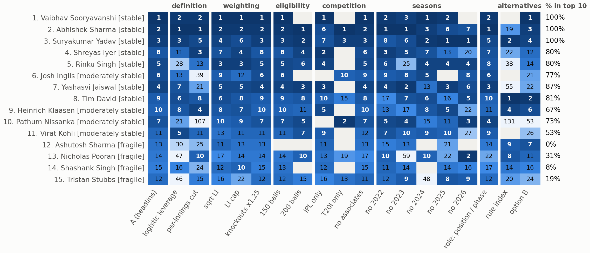

*Figure 6. Seven of the ten batters are in the top 10 in at least 80% of variants; the three moderately stable batters (Inglis, Klaasen, Nissanka) are the ones to treat as close calls.*

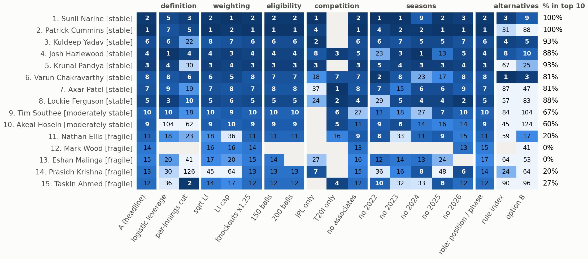

*Figure 7. Eight of the ten bowlers are stable; Southee and Hosein are moderately stable, and every bowler ranked 11–15 is fragile.*

The number of the headline top 10 kept under each variant is tabulated in Appendix C.

- **Rating choices barely matter:** weights, knockout weight, eligibility and role baselines leave 9–10 of the top 10 in place, and excluding associate matches 8–10. The exception is eligibility at 200 balls for batters (7 of 10): Sooryavanshi and Inglis fall below the bar, and Klaasen slips to 11th.
- **The data matter:** dropping a season changes 1–4 names; single-competition rankings change more, partly because they shrink the pool to 67–82 players.
- **The definition of pressure matters most:** the per-innings cut changes 4–5 names and the rule index 6–7, as expected for genuinely different definitions.

### 5.2 Volume

Players with more pressure balls rank somewhat higher (rank correlation of rating with pressure balls 0.41 for batters, 0.32 for bowlers), but almost all of that is already in the raw records (0.35 and 0.30): better players are picked more often and so face more pressure balls. Shrinkage adds little. Cutting every player to 100 pressure balls, the top 10's average chance of staying in the top 10 is 0.43 (batters) and 0.38 (bowlers).

### 5.3 The uplift ("clutch") finding

**What the brief asks:** how players perform under pressure compared with their usual level. We measured exactly that: uplift = pressure value minus the player's own ordinary-ball value, matched for phase, both against same-situation expectation and adjusted for opposition.

**What the data say.** Split each player's matches into two random halves. Does a player with high uplift in one half also have high uplift in the other? **No**: the reliability of uplift is 0.00 for batters and −0.07 for bowlers (Figure 8). Pressure value itself does reproduce (0.33 and 0.19).

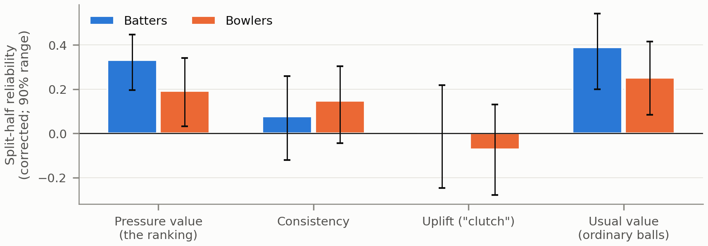

*Figure 8. Pressure performance and usual performance reproduce between halves of a player's matches; the gap between them (uplift) does not.*

**What follows.**

- **With five seasons of data, we cannot tell which players raise or lower their game under pressure.** If such a trait exists, it is too small to see against the noise at 100–888 pressure balls per player (median 206 for batters, 221 for bowlers).
- **We can tell, with stated uncertainty, who performed well when it mattered.** That is what the ranking is built on, and uplift is reported for every player with weight zero.
- **The caveat for the labels.** "Pressure-specific" players delivered under pressure well beyond their usual level in 2022–26. Because pressure-versus-usual gaps do not reproduce across matches, the label describes what they did in this window; it is not a prediction that they will keep outperforming their usual level.

### 5.4 Limitations and data issues

- **One rating per player for 2022–26.** Players change (form, age, role); the rating describes the whole period. The leave-one-season-out variants show how much any one season matters.
- **Pressure is largely a chase phenomenon** (§1.5), so a player's evidence depends on how often their side batted second.
- **Reliability is modest** (0.33 and 0.19), so places 8–15 are close calls; the stability classes and intervals say which.
- **The wicket-cost calibration is measured on first innings** and assumed to hold in chases, where the runs a wicket can cost are capped by the target.
- **Possible slight overcorrection** of batting against the four "other full members" (−3.3, within one standard error, §3.2).
- **The posterior holds the spread across players at its estimate**, so the intervals are slightly too narrow.
- **Two source-data errors** were found by reconciling ball totals with official results (803 of 805 checkable matches reproduce): a missing delivery in match 14130 and a wrong result string in match 20190. Both are too small to matter and are left as is.
- **Data.** Rain-affected matches are left out of win-probability training and scored with their revised overs and target; six second innings with no usable target are not scored. No T20 World Cup is in the data (T20Is are bilateral series, tri-series and Asia Cups), and super overs are excluded. Names are the official spellings from the competition-team-player mapping file, and every row carries `player_id`.

**With more data** we would add a recency weighting (so the rating tracks current form), venue and pitch effects (too few matches per venue here), fielding and run-out blame, and a test of uplift on a longer record, which is the only way to settle whether "clutch" exists at a measurable size.

---

## 6. Insights

1. **Pressure concentrates in chases.** 89% of high-pressure balls are in the second innings, and the share of a batter's balls that are high pressure depends mostly on how often their side chased. Any pressure ranking is largely a ranking of chasing performance; ours says so rather than hiding it.
2. **Required-rate rules flag the wrong balls.** Only 24% of the balls a required-rate-and-wickets rule calls "high pressure" are in leverage's top quarter, chance level. The rule rewards lost causes such as "need 60 off 12, 8 down" (win probability 0.0%).
3. **IPL runs are worth more than T20I runs.** On a common scale an average IPL performance is worth 10.7 runs per 100 balls more than an average T20I performance for batters (4.6 for bowlers).
4. **Sunil Narine is near the bottom as a batter and at the top as a bowler.** Among the 121 batters with at least 500 balls he ranks 107th on opposition-adjusted value (116th on raw value), yet he is the #1 pressure bowler. Both are measured with the same yardstick on different balls, so a player can sit at both ends.
5. **Clutch ability does not reproduce.** A player's pressure-minus-usual gap in one half of their matches says nothing about the other half (reliability 0.00 batters, −0.07 bowlers). Pressure performance itself does reproduce.

---

## Appendix A. The leave-one-out leak

**What was planned.** The season's scoring rate, used as context in the models, was first computed excluding the match the ball belongs to, to keep a match's own scoring out of its own context.

**What went wrong.** Subtracting one match from a season's total leaves a number that is different for almost every match (817 distinct values across 837 matches) and that mirrors the match's own scoring. A flexible model can use it to recognise an individual match and recall how it went. On training seasons this looks like skill; on a held-out season it fails.

| Held-out log-loss (coin flip 0.6931) | Plain season average | Excluding the match itself | Change |
|---|---|---|---|
| LightGBM | 0.5297 | **0.8052** | +0.2755 |
| XGBoost | 0.5223 | **0.6510** | +0.1287 |
| Logistic regression | 0.5137 | 0.5147 | +0.0009 |

The LightGBM model became worse than a coin flip. **The fix** is the plain season average: one value per season and competition. It was caught only because every model was tested on unseen seasons; a random split of balls would have put the same match on both sides and rewarded the leak. Since then, no model feature may take a value that is nearly unique to a match.

## Appendix B. Further model evidence

**Win-probability models, full comparison** (held-out seasons, 185,070 balls).

| Model | Log-loss all | First innings | Chase | Chase, last 30 balls | Brier score | Calibration error |
|---|---|---|---|---|---|---|
| Logistic regression | 0.5137 | 0.6266 | 0.3909 | 0.2437 | 0.1743 | 0.0087 |
| XGBoost | 0.5223 | 0.6376 | 0.3968 | 0.2510 | 0.1765 | 0.0252 |
| LightGBM | 0.5297 | 0.6412 | 0.4083 | 0.2620 | 0.1786 | 0.0325 |
| DP | 0.5176 | 0.6340 | 0.3911 | 0.2340 | 0.1746 | 0.0269 |
| DP + recalibration | 0.5165 | 0.6312 | 0.3916 | 0.2382 | 0.1753 | 0.0131 |

**Context features tested.** Removing the season's scoring rate from the chosen model raises log-loss from 0.5165 to 0.5222. An Impact Player flag changes it by −0.0006 (dropped). Pre-match team strength and venue add little to a simple model and act as match fingerprints in a flexible one (not used). Knockout matches show no sign of being played differently at the same match state, so there is no knockout multiplier in the headline (×1.25 is a robustness variant).

**Expectation models** (held-out seasons; lower is better).

| Expectation | Measure | Season × phase average | Full model |
|---|---|---|---|
| Runs off the bat | Squared error | 3.034 | 2.949 |
| Striker dismissed | Log-loss | 0.2045 | 0.2028 |
| Runs charged to bowler | Squared error | 2.948 | 2.871 |
| Bowler-credited wicket | Log-loss | 0.2001 | 0.1987 |

**Agreement with traditional numbers** (players with at least 500 balls): run value correlates +0.77 with strike rate and +0.49 with batting average; −0.69 with economy rate and −0.37 with balls per wicket. It moves with both the scoring-rate and the wicket number and is identical to neither.

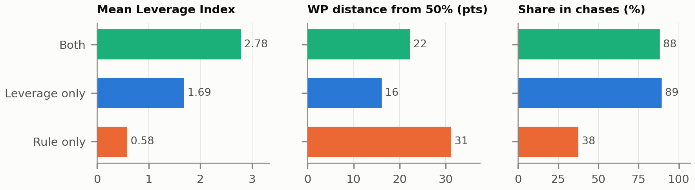

*Figure A1. Balls flagged only by the rule index are in lopsided, low-leverage games; balls flagged only by leverage are early and mid-chase balls in even contests.*

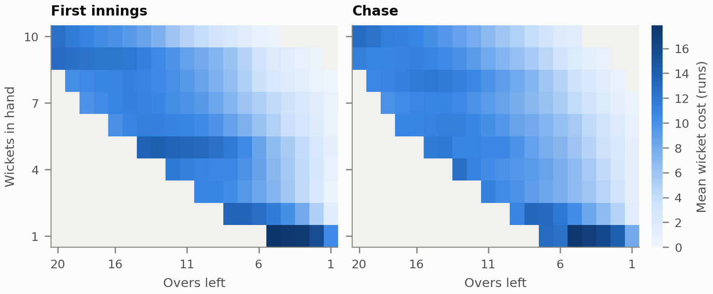

*Figure A2. A wicket costs less as the innings runs out and more when few wickets remain, which is cricket logic, not an assumption we imposed.*

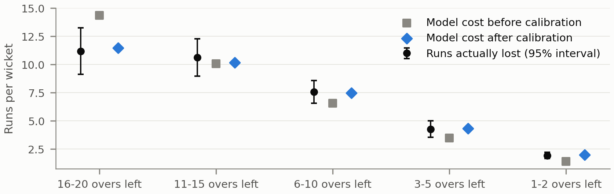

*Figure A3. After calibration the model's wicket cost matches the runs actually lost in every overs-left band.*

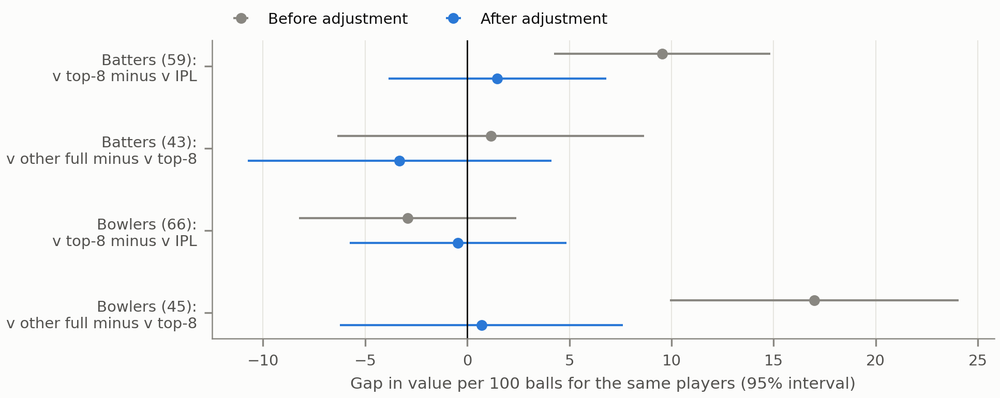

*Figure A4. After the opposition adjustment, the same players' value no longer depends on who they faced.*

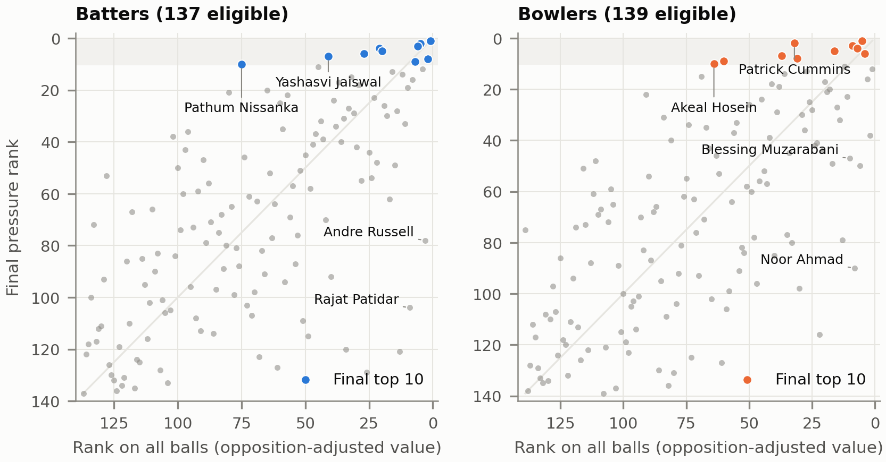

*Figure A5. Overall quality and pressure performance are related but far from the same: several of the best all-ball players sit well outside the pressure top 10.*

## Appendix C. Ranks 11–15 and sensitivity counts

**Batters**

| # | Player | ID | Team(s) | Pressure balls | Rating | Shrunk value | 90% interval | Consistency | P(top 10) | Stability | Label |
|---|---|---|---|---|---|---|---|---|---|---|---|
| 11 | Virat Kohli | 47 | India, Royal Challengers Bengaluru | 603 | 1.39 | 19.6 | 4.4 to 34.9 | +2.0 | 0.20 | moderately stable (53%) | All-round |
| 12 | Ashutosh Sharma † ‡ | 8101 | Delhi Capitals, Punjab Kings | 143 | 1.22 | 19.6 | −2.2 to 40.8 | +0.6 | 0.22 | fragile (0%) | All-round |
| 13 | Nicholas Pooran ‡ | 3125 | Lucknow Super Giants, Sunrisers Hyderabad, West Indies | 515 | 1.21 | 18.3 | 2.2 to 34.2 | +1.4 | 0.15 | fragile (31%) | All-round |
| 14 | Shashank Singh † ‡ | 2756 | Punjab Kings, Sunrisers Hyderabad | 161 | 1.21 | 16.6 | −4.7 to 38.2 | +2.4 | 0.22 | fragile (8%) | All-round |
| 15 | Tristan Stubbs ‡ | 20702 | Delhi Capitals, Mumbai Indians, South Africa | 317 | 1.36 | 15.4 | −2.9 to 33.1 | +4.4 | 0.23 | fragile (19%) | All-round |

‡ Set by the tie-break: Ashutosh Sharma (A 13, B 7) cannot be told apart from Tristan Stubbs (A 12, B 24), so B orders them. Nicholas Pooran (A 14, B 11) cannot be told apart from Tristan Stubbs (A 12, B 24), so B orders them. Shashank Singh (A 15, B 16) cannot be told apart from Tristan Stubbs (A 12, B 24), so B orders them.

**Bowlers**

| # | Player | ID | Team(s) | Pressure balls | Rating | Shrunk value | 90% interval | Consistency | P(top 10) | Stability | Label |
|---|---|---|---|---|---|---|---|---|---|---|---|
| 11 | Nathan Ellis | 7920 | Australia, Chennai Super Kings, Punjab Kings | 280 | 1.33 | 6.2 | −8.4 to 20.2 | +3.0 | 0.22 | fragile (20%) | All-round |
| 12 | Mark Wood † ‡ | 2985 | England, Lucknow Super Giants | 108 | 1.14 | 6.0 | −9.5 to 21.8 | +2.1 | 0.19 | fragile (0%) | Pressure-specific |
| 13 | Eshan Malinga † ‡ | 39657 | Sri Lanka, Sunrisers Hyderabad | 171 | 1.10 | 3.2 | −11.7 to 18.3 | +3.5 | 0.18 | fragile (0%) | Pressure-specific |
| 14 | Prasidh Krishna ‡ | 4489 | Gujarat Titans, India, Rajasthan Royals | 353 | 1.15 | 5.0 | −8.6 to 18.6 | +2.7 | 0.17 | fragile (20%) | Pressure-specific |
| 15 | Taskin Ahmed ‡ | 2681 | Bangladesh | 260 | 1.20 | 3.9 | −11.0 to 18.7 | +3.6 | 0.19 | fragile (27%) | Pressure-specific |

‡ Set by the tie-break: Mark Wood (A 14, B 41) cannot be told apart from Prasidh Krishna (A 13, B 64) and Taskin Ahmed (A 12, B 96), so B orders them. Eshan Malinga (A 15, B 53) cannot be told apart from Prasidh Krishna (A 13, B 64) and Taskin Ahmed (A 12, B 96), so B orders them.

Several players here have a P(top 10) as high as places 9–10 but are fragile: they reach the top 10 in few of the 16 variants, usually because a short record makes their estimate swing (Ashutosh Sharma, Mark Wood). The stability guard keeps them out.

How many of the headline top 10 stay in the top 10 under each variant:

| Variant | Batters | Bowlers | | Variant | Batters | Bowlers |
|---|---|---|---|---|---|---|
| √LI weight | 10 | 10 | | IPL only | 8 | 5 |
| LI cap weight | 9 | 10 | | T20I only | 4 | 6 |
| Knockouts ×1.25 | 10 | 10 | | Without 2022 | 8 | 7 |
| Eligibility 150 | 10 | 10 | | Without 2023 | 8 | 8 |
| Eligibility 200 | 7 | 10 | | Without 2024 | 8 | 7 |
| Associates excluded | 10 | 8 | | Without 2025 | 6 | 7 |
| Position / phase relative | 9 | 10 | | Without 2026 | 7 | 9 |
| Logistic leverage | 6 | 9 | | Per-innings cut | 6 | 5 |
| *Rule index (alternative)* | *3* | *4* | | *Option B (alternative)* | *5* | *4* |

## Appendix D. Decision log (summary)

The full log with alternatives and evidence is `DECISIONS.md` (D1–D40). The decisions that shape the result:

| Decision | Choice | Main alternative rejected, and why |
|---|---|---|
| Scope | IPL and T20I, 2022–26; A-team events and super overs excluded | Including A-team events: lower standard, not in the brief |
| Pressure | Leverage Index, one top-25% cut for the whole match | Rule-based index (flags lost causes); a cut per innings (would call below-average balls "high pressure") |
| WP model | DP + recalibration | Logistic regression (tied overall, worse at the end of chases); tree models (less accurate, noisy leverage) |
| Value | Run value with a calibrated, state-dependent wicket price | Win probability added as the main unit (already leverage-weighted) |
| Fairness | Ridge opposition model with tiers, split by IPL participation | Unsplit tiers (closed only 36% of the IPL–T20I gap for batters) |
| Weights | Split-half reliability, no hand-set weights | Fixed weights such as 50/30/20 |
| Intervals | Posterior simulation | A corrected bootstrap (an ad hoc fix) |
| Ordering | A, pairwise tie-break by B, stability guard | A chained tie-break (would let B decide the whole order) |

## Appendix E. Reproducibility

- **One command:** `python -m src.pipeline --force` rebuilds everything from the six raw CSVs: audit, models, tables, rankings, report figures, the cross-check and this PDF (`python -m src.report.build_pdf` rebuilds the PDF alone). Without `--force` the two slow model stages are reused from cache.
- **Runtime:** the last full `--force` run took about 52 minutes on a 4-core Windows laptop; a cached run takes under 15 minutes.
- **Fixed seeds** (`seed: 42` in `config.yaml`); a fresh `--force` run reproduced all 100 compared output tables and ball files exactly.
- **No magic numbers:** every threshold, model setting and label is in `config.yaml`.
- **Environment:** Python 3.12.1, every package version pinned in `requirements.txt`.
- **Tests:** `pytest` covers the cricket logic (ball flags, match state, the DP, pressure, run value, the opposition model, ratings, the tie-break, the stability guard and the labels).
- **Cross-check:** `python -m src.report.check_report` recomputes the numbers quoted in this report from the output tables and writes `outputs/report/crosscheck.md`, listing any mismatch and any number not covered by a check.
- **No leakage:** every model output for a ball comes from models that did not see its season; validation is on held-out seasons and held-out matches, never random splits of balls.
